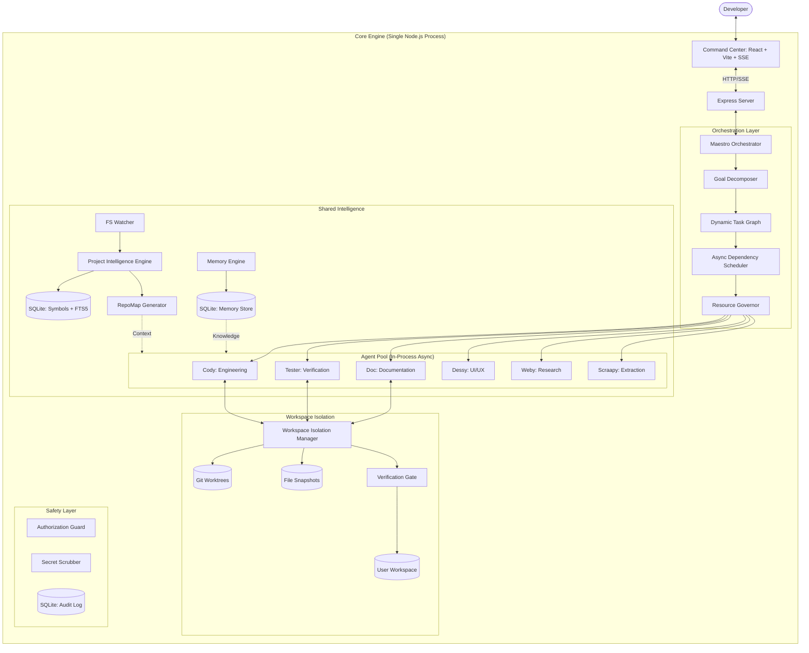
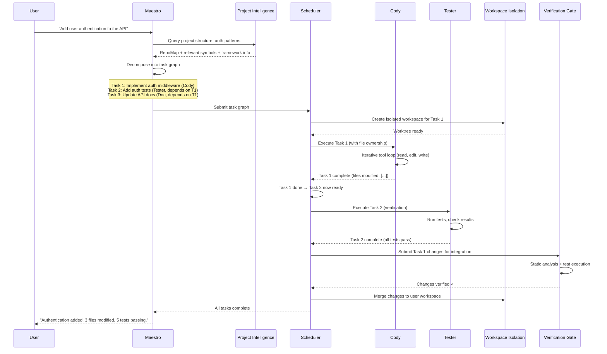

# CORRECTED ARCHITECTURE — MedioBot V2

> **Author:** Principal AI Systems Architect (Opus Audit)
> **Date:** 2026-10-13
> **Status:** FINAL RECOMMENDED ARCHITECTURE
> **Supersedes:** RECOMMENDED_ARCHITECTURE.md (preserved as historical reference)

---

## 1. Executive Summary

MedioBot V2 evolves from a sequential coding assistant into an **Adaptive Multi-Agent Software Engineering System**. The corrected architecture retains the "Agile Pod" metaphor but replaces rigid wave scheduling with **async dependency-driven execution**, adds **durable task persistence**, and requires **non-Git project support**.



---

## 2. Key Architectural Corrections

### 2.1 Async Dependency Scheduler (Replaces Wave Barriers)

**Previous:** Strict topological wave scheduling — all tasks in wave N must complete before wave N+1 begins.

**Corrected:** Each task tracks its own dependency set. A task becomes **ready** the moment ALL its declared dependencies resolve (not when the entire wave completes). This enables:
- Faster overall execution (no waiting for slow siblings)
- Natural handling of diamond dependencies
- Simpler scheduler logic (priority queue + dependency check)

```typescript
// PROPOSED — Corrected scheduling model
interface TaskNode {
  readonly id: TaskId;
  readonly agentId: MediobotDefinitionId;
  readonly objective: string;
  readonly dependencies: ReadonlyArray<TaskId>; // Empty = immediately ready
  readonly fileOwnership: ReadonlyArray<string>; // Exclusive file claims
  readonly status: 'pending' | 'ready' | 'running' | 'completed' | 'failed' | 'cancelled';
}

interface TaskGraph {
  readonly nodes: Map<TaskId, TaskNode>;
  markComplete(taskId: TaskId): ReadonlyArray<TaskId>; // Returns newly-ready tasks
  markFailed(taskId: TaskId): ReadonlyArray<TaskId>;   // Returns tasks to cancel
}
```

### 2.2 Durable Task Persistence

**Previous:** Task state held entirely in memory (InMemoryWorld).

**Corrected:** Critical task state persisted to SQLite so that:
- Long-running multi-agent operations survive process restarts
- Failed tasks can be resumed from the last checkpoint
- Audit trail is automatically maintained

```sql
-- PROPOSED — Task persistence schema
CREATE TABLE IF NOT EXISTS task_executions (
  task_id        TEXT PRIMARY KEY,
  agent_id       TEXT NOT NULL,
  objective       TEXT NOT NULL,
  status          TEXT NOT NULL DEFAULT 'pending',
  dependencies    TEXT NOT NULL DEFAULT '[]', -- JSON array of task_ids
  file_ownership  TEXT NOT NULL DEFAULT '[]', -- JSON array of file paths
  result_summary  TEXT,
  error_message   TEXT,
  created_at      INTEGER NOT NULL DEFAULT (unixepoch()),
  started_at      INTEGER,
  completed_at    INTEGER,
  parent_goal_id  TEXT -- Links to the user's original request
);
```

### 2.3 Dual Workspace Isolation (Git + File Snapshots)

**Previous:** Git worktrees only. Non-Git projects unsupported.

**Corrected:** Two isolation strategies:

| Strategy | When Used | Mechanism |
|----------|-----------|-----------|
| **Git Worktrees** | Project has `.git/` directory | `git worktree add` with task-scoped branches |
| **File Snapshots** | Non-Git projects OR user preference | Copy-on-write file snapshots in `.mediobot/snapshots/` |

Both strategies route through a unified `WorkspaceIsolationManager` interface.

### 2.4 Adaptive Agent Activation

**Previous:** Implied all agents might be activated for complex tasks.

**Corrected:** Explicit activation rules:

| Task Complexity | Active Agents | RAM Target |
|----------------|---------------|------------|
| Simple (chat, explain) | Maestro only | < 200 MB |
| Single-file edit | Maestro + Cody | < 400 MB |
| Multi-file feature | Maestro + Cody + Tester | < 800 MB |
| Complex refactor | Maestro + 2-4 specialists | < 1.5 GB |
| Full parallel | Maestro + up to 8 specialists | < 3 GB (requires ≥ 16 GB RAM) |

These are **targets to benchmark**, not guarantees.

---

## 3. Component Responsibilities (Corrected)

### 3.1 Maestro (Orchestrator)
- **RETAIN:** Decision contract system, evidence classification, structural JSON validation
- **EXTEND:** Dynamic task graph construction, async scheduling, progress ledger, human approval gates
- **MODIFY:** Replace single-delegate model with multi-task dispatch capability

### 3.2 Cody (Software Engineer)
- **RETAIN:** Iterative tool loop, structural normalizer, verification requirement
- **EXTEND:** Accept file ownership constraints from scheduler, report file modifications back
- **MODIFY:** Increase step limit from 12 to adaptive (based on task complexity estimate)

### 3.3 Tester (Verification)
- **RETAIN:** Test execution, exit code verification
- **EXTEND:** Independent verification of Cody's work (not just text worker), regression detection
- **STATUS:** Currently text-worker only; must become full tool-capable agent

### 3.4 Project Intelligence Engine (NEW)
- **PURPOSE:** Replaces `discoverProjectIntelligence` with deep AST-based project understanding
- **DETAILS:** See [PROJECT_INTELLIGENCE_SPEC.md](file:///Users/rahulkarthikt/Documents/mediobot/mediobot-v2/docs/advanced-orchestration-research/PROJECT_INTELLIGENCE_SPEC.md)

### 3.5 Memory Engine (NEW)
- **PURPOSE:** Cross-session knowledge persistence with provenance
- **DETAILS:** See [MEMORY_AND_KNOWLEDGE_SPEC.md](file:///Users/rahulkarthikt/Documents/mediobot/mediobot-v2/docs/advanced-orchestration-research/MEMORY_AND_KNOWLEDGE_SPEC.md)

### 3.6 Doc, Dessy, Weby, Scraapy (DEFERRED)
- **STATUS:** Currently unimplemented (Doc has stub; others don't exist in code)
- **RECOMMENDATION:** Implement as Phase 7+ after core orchestration is proven. Each requires a clear tool contract and bounded responsibility.

---

## 4. Data Flow Architecture



---

## 5. Technology Stack (Corrected)

| Component | Technology | Status | Rationale |
|-----------|-----------|--------|-----------|
| Runtime | Node.js (single process) | **VERIFIED** (existing) | Shared V8 heap for all agents |
| UI | React + Vite + SSE | **VERIFIED** (existing) | Already working in Command Center |
| AST Parsing | web-tree-sitter (WASM) | **PROPOSED** | Multi-language, incremental, proven |
| TS Type Checking | TypeScript Compiler API | **PROPOSED** (DVG only) | Only for type-error detection, not general parsing |
| Symbol Storage | SQLite + FTS5 | **PROPOSED** | Fast full-text + structured queries, zero-config |
| Memory Storage | SQLite (same DB or separate) | **PROPOSED** | Avoids new infrastructure |
| Vector Embeddings | sqlite-vec | **DEFERRED** | Add only when FTS5 retrieval is measurably insufficient |
| File Watching | Chokidar v4 | **PROPOSED** | Cross-platform, debounced, mature |
| Git Integration | Native git CLI | **PROPOSED** | Worktrees, branches, merge — no library needed |
| Non-Git Isolation | File-level copy snapshots | **PROPOSED** | Simple, universal fallback |
| Task Persistence | SQLite | **PROPOSED** | Durable execution without external services |
| LLM Providers | OpenAI, Anthropic, Google, local | **VERIFIED** (existing) | Multi-provider support already built |

---

## 6. What MUST Be Preserved

1. **MaestroDecisionProvider** contract system (packages/maestro/src/index.ts)
2. **Structural JSON validation** with bounded repair loop
3. **Evidence classification** (`basis: "project-evidence"` enforcement)
4. **Security: path containment**, secret scrubbing, sensitive name detection
5. **InMemoryWorld** event system (extend, don't replace)
6. **Command Center UI** (apps/command-center — no changes in this audit)
7. **Worker lifecycle** (packages/runtime — extend with adaptive concurrency)
8. **Cody's tool loop** and verification requirements
9. **All SQLite schemas** in current database files

---

## 7. What MUST Be Modified

1. **Maestro**: Add multi-task dispatch, progress ledger, adaptive replanning
2. **Runtime**: Add resource governor, adaptive concurrency limits, task persistence
3. **Discovery**: Replace 35-file scan with Project Intelligence Engine
4. **Tester**: Upgrade from text-worker to tool-capable verification agent
5. **Workspace Manager**: Add Git worktree support and file snapshot fallback
6. **Event System**: Extend for multi-agent progress streams

---

## 8. Verification Status

| Component | Status |
|-----------|--------|
| Existing Maestro decision contract | **VERIFIED** — code reviewed |
| Existing Cody tool loop | **VERIFIED** — code reviewed |
| Existing security boundaries | **VERIFIED** — code reviewed |
| Existing UI (Command Center) | **VERIFIED** — running on dev server |
| Proposed Project Intelligence Engine | **PROPOSED** — not implemented |
| Proposed Async Scheduler | **PROPOSED** — not implemented |
| Proposed Durable Task Persistence | **PROPOSED** — not implemented |
| Proposed Memory Engine | **PROPOSED** — not implemented |
| Proposed Dual Validation Gate | **PROPOSED** — not implemented |
| All quantitative performance targets | **UNTESTED** — require benchmarking |

---

## 9. Architectural Safety Contracts (Non-Negotiable Invariants)

To ensure the safety, stability, and integrity of user environments, the following 10 safety contracts are absolute architectural invariants across all MedioBot V2 subsystems:

1. **Never automatically delete user databases:**
   Under no circumstances may SQLite corruption, schema migration errors, or startup failures automatically delete, drop, or purge user database files. Corrupt files must be quarantined with timestamped backup paths (`.corrupt-<timestamp>`), and the failure surfaced transparently to the user.

2. **Never automatically stash or reset user changes:**
   The user's working-tree state belongs solely to the user. Orchestration, workspace isolation, and agent lifecycles must never execute `git stash`, `git reset --hard`, or `git checkout -- .` on the user's working tree. Uncommitted changes must remain completely untouched.

3. **Never overwrite user files during isolation setup:**
   Workspace isolation mechanisms (Git worktrees, snapshot copies) must never overwrite, truncate, or overwrite existing files in the user workspace. Isolation directories must reside outside or within designated, git-ignored scratch boundaries, with collisions treated as hard errors.

4. **Never bypass workspace authorization:**
   All agent tools, filesystem reads/writes, directory discovery, and terminal execution must be strictly scoped to the authorized canonical workspace root. Traversal escapes, symlink redirection outside the workspace, drive-relative paths, and UNC attacks must fail closed.

5. **Never fabricate tool evidence:**
   Evidence records must reflect actual, deterministic executions. Models, orchestrators, and workers must never synthesize, hallucinate, or mock tool execution results as verified facts. Every evidence item requires verifiable source attribution (command, exit code, file hash, stdout/stderr).

6. **Never mark unsupported model claims as verified:**
   Model statements, answers, and summaries must remain labeled as `observed` or `unverified` unless proven by fresh deterministic verification tools (e.g., test suite execution). Untested models (including live MiniMax endpoints without verified end-to-end network resolution) must remain explicitly flagged as unverified.

7. **Never automatically merge unverified agent changes:**
   Changes produced by autonomous agents must pass the Dual Validation Gate (syntax, import integrity, compilation, and regression tests) before integration into the primary workspace. Failed verification blocks automatic integration; force-merges require explicit, manual user authorization.

8. **Never enable untested subsystems by default:**
   New subsystems (such as the Project Intelligence Engine, Memory Engine, and Multi-Agent Parallel Scheduler) must start behind disabled feature flags (e.g., `USE_PROJECT_INTELLIGENCE=false`). Proven legacy paths (such as `discoverProjectIntelligence`) must remain active as reliable fallbacks.

9. **Never execute unbounded parallel tasks:**
   Parallel execution must be strictly governed by resource limits and concurrency quotas. The Resource Governor and exclusive File Ownership Registry must precede any concurrent agent dispatch. Concurrency limits are tuned to system hardware (e.g., 2 agents on 8GB, 4 on 16GB, max 8 on 32GB).

10. **Preserve cancellation and failure propagation:**
    Abort signals, user cancellation requests, and child task failures must propagate immediately across the entire execution tree. Cancellation must release held resources, abort active child processes, and terminate pending tasks without zombie execution or swallowed errors.

