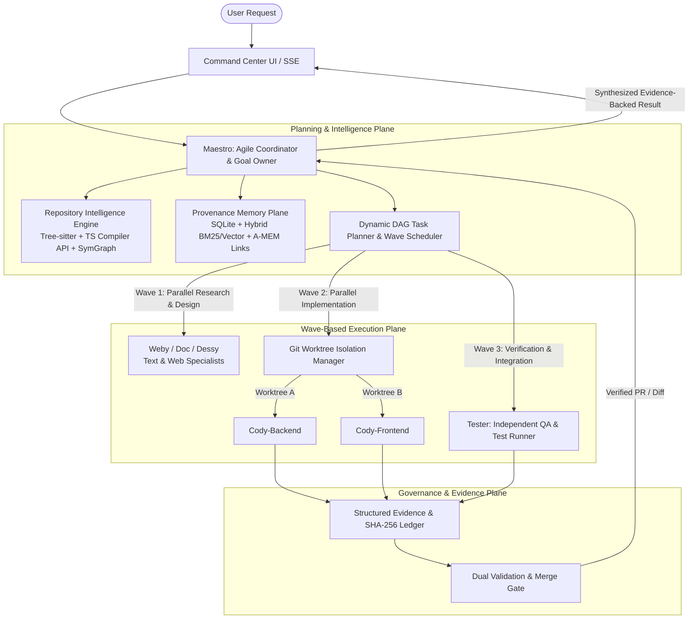

# MedioBot V2 — Advanced Autonomous Multi-Agent Architecture Research
## Deliverable 1: Executive Summary

---

### 1. Research Mandate & Context

MedioBot V2 is transitioning from a nascent multi-agent coding prototype into an industrial-grade, autonomous, collaborative software engineering environment. The overarching vision is an **AI-native Agile software development organization**: a coordinator agent (**Maestro**) leads a dynamic team of specialized engineering agents (**Cody**, **Tester**, **Doc**, **Vision**, and future specialists) that can concurrently plan, investigate, implement, test, and verify complex software projects.

This research investigation was conducted under strict architectural guidelines:
* **Research and architecture design only**: Zero premature production code changes.
* **Grounded in code reality**: Direct inspection of the active MedioBot V2 repository (`mediobot-v2`), separating actual implementation from planned or advertised product roles.
* **Literature-grounded**: Deep examination of peer-reviewed and state-of-the-art multi-agent research papers (Magentic-One, SPOQ, Agyn, ALMAS, AsynCodeBench, Prometheus, abcoder-ts-parser, A-MEM, D-MEM, Jev-Mem) and empirical benchmarks (SWE-bench Verified, GAIA, WebArena).
* **System resource realism**: Engineering constraints for personal workstations (8 GB, 16 GB, 32 GB RAM on Apple Silicon macOS and Windows 11).

---

### 2. Core Diagnoses of the Current Repository

Our audit of the active MedioBot V2 codebase revealed solid foundational engineering alongside severe architectural bottlenecks:

| Dimension | Current State in MedioBot V2 | Architectural Assessment |
| :--- | :--- | :--- |
| **Orchestration** | Strict 2-turn single-delegation pattern (`Maestro` $\to$ 1 `Cody` or text workers $\to$ `synthesis`). Fixed serial loops. | **Bottleneck**: No dynamic task graph (DAG), no multi-agent concurrency, no iterative re-delegation or adaptive planning loops. |
| **Project Intelligence** | Shallow directory sampling in `packages/maestro/src/discovery.ts` (caps at 35 top-level entries, samples basic manifests). | **Critical Defect**: Operates as a "blind assistant." No AST analysis, no symbol resolution, no call/import graphs, no semantic search. |
| **Agent Roster** | Only `Maestro`, `Cody`, `Vision`, and mock text-workers exist in code. `Dessy`, `Weby`, `Scraapy` are purely conceptual product names. | **Reality Gap**: Product vision assumes 4–8+ specialists, but runtime only supports 1 active tool-executing worker (`Cody`) at a time. |
| **Workspace & Concurrency** | Single shared `workspaceRoot` with in-memory mutex (`writeLocks` per path). Tool permissions contained via `realpath`. | **Blocker for Concurrency**: If multiple agents wrote to the workspace simultaneously, they would cause race conditions, corrupt Git state, and overwrite edits. |
| **Memory System** | Pure SQLite conversation turn history (`turns`, `items`, `evidence`). No semantic memory, no cross-thread recall. | **Static**: Cannot recall architectural decisions, user preferences, or debugging heuristics across separate threads. |
| **Verification & Grounding** | Rigorous evidence-grounding engine in `MaestroDecisionProvider` and `Tester` verification runner. | **Major Strength**: Strong, well-tested invariant checking (`projectEvidenceRequired`, `ToolPermissionEngine`, SHA-256 diff tracking). |

---

### 3. Key Research Findings

1. **Topological Wave Dispatch Beats Flat Pipelines (SPOQ & AsynCodeBench)**:
   Research from SPOQ (Carbowitz & Kumar, 2026) demonstrates that decomposing user goals into a **Directed Acyclic Graph (DAG)** of subtasks and executing them in **topological waves** yields a 1.4× to 14.3× speedup while cutting defect rates from 0.34 to 0.20 per task. Multi-agent coding fails when coordination is unguided, but excels when cross-agent dependencies are explicitly tracked.

2. **Compiler API & Graph Indexing Over JSON-RPC LSP (abcoder-ts-parser & Prometheus)**:
   Per-symbol JSON-RPC calls over Language Server Protocol (LSP) create a massive latency bottleneck on large codebases. Building an AST and symbol dependency graph via the **TypeScript Compiler API / Tree-sitter** and ranking relevant files via **PageRank over code entities (Aider repomap)** achieves 74.4% on SWE-bench Verified (Prometheus) with sub-second retrieval times.

3. **Isolated Git Worktrees Are the Only Robust Concurrency Primitive**:
   Running multiple tool-executing coding agents inside a single shared working directory is fundamentally broken. **Git worktrees** (`git worktree add ../task-branch`) provide lightweight, zero-copy object database sharing while isolating the file system, test execution, and uncommitted edits into dedicated directories, enabling 4–8 agents to work simultaneously without collisions.

4. **Memory-Augmented Generation (MAG) vs. RAG**:
   While RAG performs passive, static vector lookups over chunked text, **MAG** maintains an active, mutable, structured cognitive store. The NeurIPS 2025 **A-MEM** architecture (Zettelkasten-inspired note networks with memory evolution) and **D-MEM** (dopamine/RPE-gated cognitive restructuring) enable agents to remember user preferences and architectural rules without blowing up token budgets ($O(1)$ fast access vs. $O(N)$ graph evolution).

---

### 4. The Recommended Architecture: Autonomous Agile Pod (AAP)

We recommend a **Hybrid Event-Driven Topological Architecture (Option C)** that retains MedioBot's rock-solid SQLite persistence and permission engine while introducing an enterprise-grade coordination plane:

#### Core Components of the Recommended Design:
1. **Adaptive Agent Activation**: Zero specialists for simple conversational queries; 1 worker for direct file edits; 4–8 wave-dispatched specialists for complex multi-tier application builds.
2. **Repository Intelligence Service (RIS)**: Persistent SQLite-backed symbol and dependency graph combining Tree-sitter ASTs with incremental file-watcher cache invalidation.
3. **Git Worktree Isolation Manager (WIM)**: Dynamic allocation of ephemeral worktrees for concurrent code modification, backed by automated branch synthesis and test-gated merge validation.
4. **Structured Evidence & Dual Validation Gates**: Pre-execution planning validation and post-execution automated test validation. Claims must cite concrete observed evidence references; ungrounded assertions are rejected.
5. **Lightweight Process Model for Local Workstations**: Logical in-process Node.js actor agents sharing single runtime threads for text reasoning, spawning ephemeral child processes only during actual test execution and build runs. Keeps RAM under 1.5 GB on 8 GB / 16 GB machines.

---

### 5. Implementation Roadmap Overview (Design-Only)

The proposed evolution is structured into six strictly phased, test-gated milestones:
* **Phase 1: Deep Repository Intelligence** (Tree-sitter AST, Symbol Graph, RepoMap, Hybrid Search).
* **Phase 2: Dynamic DAG Task Graph & Topological Wave Dispatch** (Magentic-One Task/Progress Ledgers, DAG Planner).
* **Phase 3: Multi-Agent Concurrency via Git Worktrees** (Isolated sandboxes, collision-free execution, merge gate).
* **Phase 4: Provenance-Aware Memory (MAG)** (SQLite episodic memory, A-MEM Zettelkasten links, cross-thread heuristics).
* **Phase 5: Specialist Expansion** (Full implementations for `Doc`, `Tester`, `Dessy`, and web intelligence).
* **Phase 6: Multi-Platform Hardening & Self-Improvement** (macOS/Windows native performance, reflection replay).

---

### 6. Summary Conclusion

MedioBot V2 has an exceptionally sound reliability core. Its strict tool permission containment, SQLite transaction model, and honest model validation error recovery place it ahead of fragile script-based agent frameworks. By upgrading its repository comprehension from directory sampling to an AST symbol graph, replacing single-turn delegation with wave-based DAG scheduling, and isolating parallel workers via native Git worktrees, MedioBot V2 can reliably deliver autonomous multi-agent engineering while maintaining absolute user control and deterministic safety.
