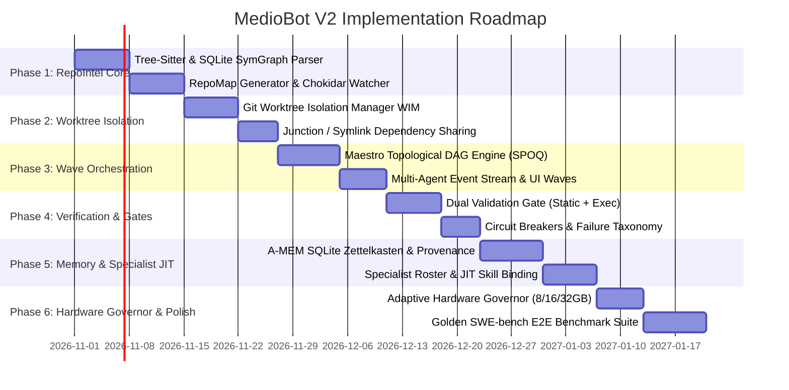

# 15. Implementation Roadmap: Phased Engineering Blueprint (Design Only)

> **Component:** Incremental Delivery Strategy & Phase Gates  
> **Status:** Architectural Design Specification (DO NOT IMPLEMENT YET)  
> **Priority:** Tier 1 — Operational Plan  
> **Authors:** Principal AI Systems Architect, Software Engineering Productivity Researcher  

---

## 1. Executive Summary & Guardrail Notice

> [!IMPORTANT]
> **THIS IS A DESIGN SPECIFICATION ONLY.**  
> In strict compliance with prompt constraints, no production code, dependencies, or migrations are to be executed during this milestone. This roadmap defines the phased implementation strategy for subsequent, explicitly authorized milestones.

The migration of MedioBot V2 from a sequential assistant to an Autonomous Agile Pod is structured into **six incremental phases**. Each phase is self-contained, delivers tangible user value, and enforces strict rollback strategies and regression gates.

---

## 2. Phase-by-Phase Technical Specifications

### Phase 1: Repository Intelligence Engine (RepoIntel)
- **Objective:** Replace naive 35-file regex scan with high-performance in-process AST and symbol graph engine.
- **Scope:**
  - Integrate `web-tree-sitter` (WASM) and TypeScript AST extractor.
  - Create `.mediobot/cache/project-intelligence.db` (SQLite SymGraph + FTS5).
  - Implement PageRank-driven budgeted RepoMap generator ($< 1,500$ tokens).
  - Connect Chokidar file watcher with 150ms debounce for incremental invalidation.
- **Dependencies:** Existing `packages/runtime/src/WorkspaceManager.ts`.
- **Acceptance Criteria:**
  - Sub-millisecond symbol lookup across a 1,000-file repository.
  - RepoMap generation takes $< 35\text{ms}$ and adheres strictly to token budgets.
  - Background watcher CPU load $\le 0.5\%$ during idle editing.
- **Regression Guard:** Fallback to legacy file inventory if SQLite database fails to initialize.
- **Rollback Strategy:** Feature flag `USE_REPO_INTEL=false` instantly restores legacy `discoverProjectIntelligence`.

---

### Phase 2: Worktree Isolation Manager (WIM)
- **Objective:** Enable concurrent filesystem operations without file overwrites or race conditions.
- **Scope:**
  - Build `GitWorktreeManager` class wrapping native `git worktree` commands.
  - Implement zero-copy `node_modules` symlinking (macOS) and directory junctions (Windows).
  - Scope all agent tool invocations (`read_file`, `write_to_file`, `run_command`) to active worktree roots.
  - Implement safe worktree pruning and cleanup on task completion.
- **Dependencies:** Phase 1; clean Git repository state.
- **Acceptance Criteria:**
  - Two agents can write to different branches of the same repo simultaneously without collision.
  - Worktree creation latency $< 250\text{ms}$.
  - Teardown prunes branches and leaves zero orphaned directories.
- **Regression Guard:** Verify repository `HEAD` remains unchanged until explicit merge.
- **Rollback Strategy:** Revert tool paths to root workspace; disable worktree flags.

---

### Phase 3: Topological Wave Orchestration (Maestro V2)
- **Objective:** Upgrade Maestro from sequential fallback turns to parallel dependency-aware DAG dispatch.
- **Scope:**
  - Implement DAG decomposition parser in `packages/orchestration/src/maestro.ts`.
  - Implement Wave-based execution loop (SPOQ pattern).
  - Connect multi-agent execution telemetry to Command Center SSE event bus.
  - Extend UI to render active parallel agents in timeline and activity drawer.
- **Dependencies:** Phase 1 and Phase 2.
- **Acceptance Criteria:**
  - Maestro successfully schedules 3 independent tasks simultaneously in separate worktrees.
  - Wave $W_{i+1}$ reliably waits for Wave $W_i$ completion.
  - UI displays live parallel thought streams without flickering.
- **Regression Guard:** Maestro defaults to single-agent sequential mode if goal DAG contains only 1 node.
- **Rollback Strategy:** Toggle `ENABLE_WAVE_ORCHESTRATOR=false` to revert to legacy Maestro linear loop.

---

### Phase 4: Reliability & The Dual Validation Gate (DVG)
- **Objective:** Eliminate hallucinations, ghost imports, and regressions before code is integrated.
- **Scope:**
  - Implement Gate 1 (Static AST validity, TypeScript `tsc --noEmit`, ghost import guard).
  - Implement Gate 2 (Targeted unit test runner, exit code verification).
  - Implement Circuit Breaker with 3-attempt ceiling and identical-action detection.
  - Implement structured failure taxonomy reporting.
- **Dependencies:** Phase 2 and Phase 3.
- **Acceptance Criteria:**
  - 100% of commits with syntax or type errors rejected before merging to `main`.
  - Looping agents terminated within 3 turns with zero runaway token costs.
- **Regression Guard:** Allow developer override via Command Center UI ("Force Merge").
- **Rollback Strategy:** Bypasses validation gates and falls back to manual developer review.

---

### Phase 5: Cognitive Memory & Specialist Agent Roster
- **Objective:** Deliver multi-tier cross-session persistence and specialized agent personas.
- **Scope:**
  - Implement SQLite A-MEM Zettelkasten note network and hybrid vector search (`sqlite-vec`).
  - Enforce "Code Truth Invariant" (provenance validation against current AST hashes).
  - Register formal runtime schemas for Tester, Doc, Dessy, Weby, and Scraapy.
  - Implement Just-in-Time (JIT) skill and tool injection based on subtask context.
- **Dependencies:** Phase 1 through Phase 4.
- **Acceptance Criteria:**
  - Agent recalls project conventions discussed in previous sessions in $< 5\text{ms}$.
  - Stale memory notes automatically invalidated when referenced files are edited.
  - System prompt overhead reduced by $> 60\%$ via JIT skill binding.
- **Rollback Strategy:** Clear `.mediobot/cache/memory.db` without affecting code repository.

---

### Phase 6: Hardware Governor & Production Hardening
- **Objective:** Optimize system for 8 GB, 16 GB, and 32 GB machines across macOS and Windows.
- **Scope:**
  - Implement dynamic memory and CPU governor (`SystemHardwareProfile`).
  - Optimize thread QoS on macOS ARM64 and Windows `EBUSY` file-lock retry wrappers.
  - Validate prompt prefix caching structure with frontier LLM providers.
  - Run full golden test benchmark suite (20 repository challenges).
- **Dependencies:** Phases 1 through 5.
- **Acceptance Criteria:**
  - Peak memory usage $\le 1.5\text{ GB}$ on 8 GB machines; $\le 3.5\text{ GB}$ on 16 GB machines.
  - 0 unhandled promise rejections or thread deadlocks across a 4-hour continuous run.
- **Rollback Strategy:** Clamp concurrency ceiling to 1 worker.

---

## 3. Summary & Transition to Open Questions

With the implementation roadmap staged and bounded, we conclude with **Deliverable 16: Open Questions and Risks**, identifying remaining technical unknowns, edge cases, and future research vectors.
