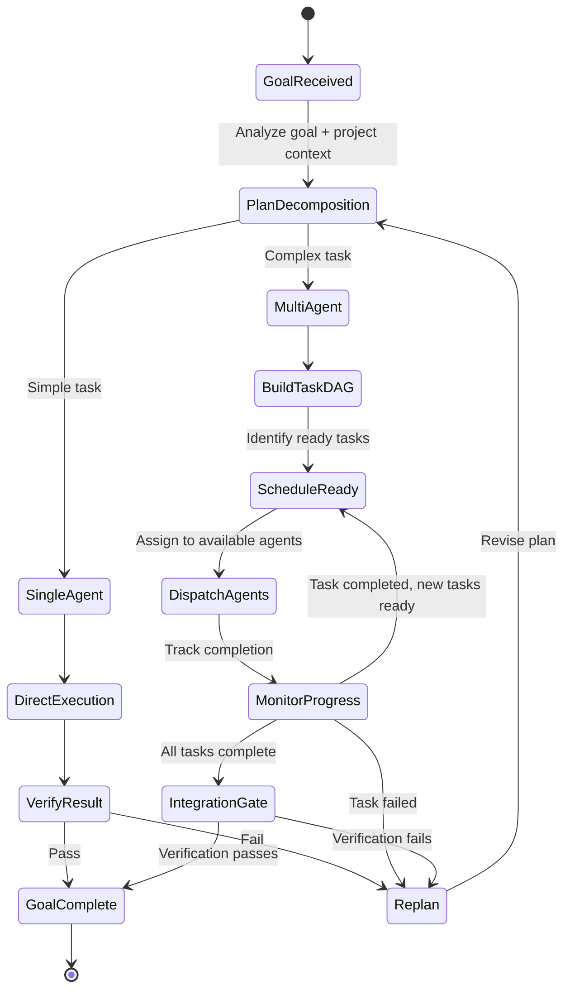
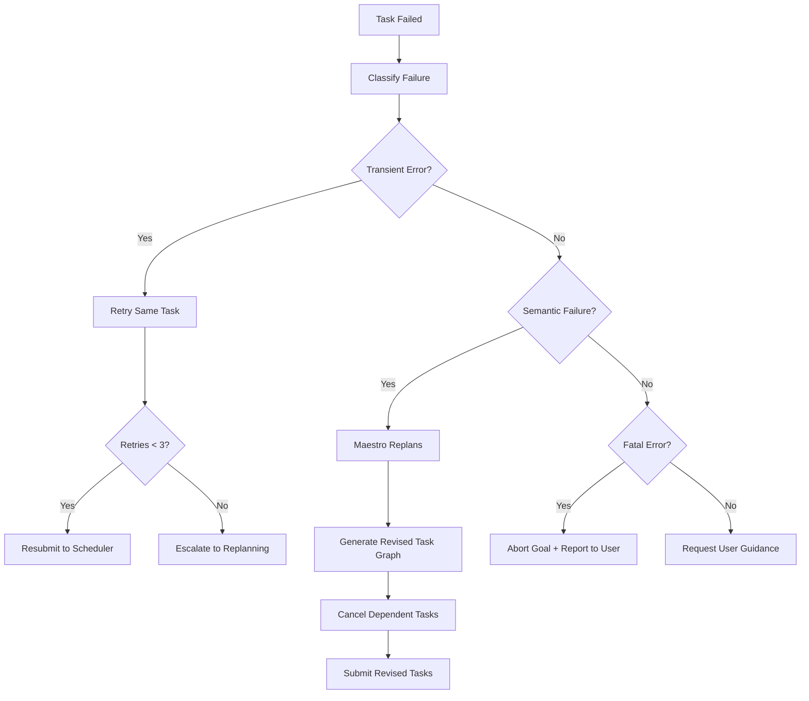

# MAESTRO ORCHESTRATION SPEC — MedioBot V2

> **Author:** Principal AI Systems Architect (Opus Audit)
> **Date:** 2026-10-13
> **Status:** PROPOSED — Core Orchestration Redesign
> **Affects:** `packages/maestro/src/index.ts`, `packages/runtime/src/index.ts`

---

## 1. Current State Analysis

The existing Maestro orchestrator (`packages/maestro/src/index.ts`, 826 lines) operates on a **single-turn, single-delegation** model:

1. Receives user message
2. Compiles context (project intelligence, conversation history, evidence)
3. Issues ONE decision (respond, delegate, delegate_text, etc.)
4. If delegated: waits for single specialist, synthesizes result
5. Returns to user

**Critical Limitations:**
- Cannot decompose a goal into multiple parallel tasks
- Cannot track progress across multi-step operations
- Cannot replan if a specialist fails or produces unexpected results
- Cannot coordinate cross-agent dependencies

---

## 2. Corrected Orchestration Model

### 2.1 Hybrid DAG + Ledger Architecture

Maestro operates two complementary coordination mechanisms:

**Task DAG:** Structural dependency graph for parallel scheduling.
**Progress Ledger:** Running narrative of facts, decisions, and evidence for adaptive replanning.



### 2.2 Decision Contract Extension

The existing `MaestroTurnDecision` type is extended with new decision types:

```typescript
// PROPOSED — Extended decision types
export type MaestroTurnDecision =
  // Existing decisions (preserved)
  | { readonly type: "respond"; readonly message: string; readonly basis: "conversation" | "project-evidence" | "cannot-verify"; readonly evidenceRefs: ReadonlyArray<string> }
  | { readonly type: "request_user_input"; readonly question: string }
  | { readonly type: "acquire_context"; readonly request: string; readonly contextKinds: ReadonlyArray<string> }
  | { readonly type: "use_capability"; readonly capability: string; readonly objective: string; readonly contextRefs: ReadonlyArray<string> }
  | { readonly type: "delegate"; readonly definitionId: string; readonly objective: string; readonly relevantContextRefs: ReadonlyArray<string>; readonly constraints: ReadonlyArray<string>; readonly expectedOutcome: string; readonly evidenceExpectations: ReadonlyArray<string> }
  | { readonly type: "delegate_text"; readonly independence: string; readonly assignments: ReadonlyArray<TextAssignmentDraft> }
  // NEW decision types
  | { readonly type: "plan_multi_task"; readonly goal: string; readonly tasks: ReadonlyArray<PlannedTask>; readonly approvalRequired: boolean }
  | { readonly type: "replan"; readonly reason: string; readonly failedTaskId: TaskId; readonly revisedTasks: ReadonlyArray<PlannedTask> };

export interface PlannedTask {
  readonly taskId: string;            // Agent-generated unique ID
  readonly agentId: string;           // Which Mediobot to assign
  readonly objective: string;         // Clear, bounded objective
  readonly dependencies: ReadonlyArray<string>; // IDs of tasks that must complete first
  readonly fileOwnership: ReadonlyArray<string>; // Files this task may modify (exclusive lock)
  readonly constraints: ReadonlyArray<string>;
  readonly expectedOutcome: string;
  readonly estimatedComplexity: "trivial" | "simple" | "moderate" | "complex";
}
```

---

## 3. Async Dependency Scheduler

### 3.1 Core Algorithm

```
function scheduleLoop(taskGraph):
  readyQueue = tasks with no pending dependencies
  runningTasks = {}

  while readyQueue is not empty OR runningTasks is not empty:
    // Check resource availability
    availableSlots = resourceGovernor.availableAgentSlots()

    while readyQueue is not empty AND availableSlots > 0:
      task = readyQueue.dequeue()

      // Check file ownership conflicts
      if fileOwnershipConflict(task, runningTasks):
        readyQueue.defer(task)  // Re-check after a running task completes
        continue

      workspace = workspaceIsolation.create(task)
      agent = agentPool.acquire(task.agentId)
      runningTasks[task.id] = { task, agent, workspace }
      agent.execute(task, workspace)  // Non-blocking
      availableSlots--

    // Wait for any task to complete
    completedTask = await Promise.race(runningTasks.values())

    if completedTask.status == 'completed':
      // Release file ownership
      // Check which pending tasks are now ready
      newlyReady = taskGraph.markComplete(completedTask.id)
      readyQueue.enqueue(newlyReady)
    else if completedTask.status == 'failed':
      // Notify Maestro for replanning decision
      // Optionally cancel dependent tasks
      cancelledTasks = taskGraph.markFailed(completedTask.id)
      notify Maestro with failure details

    remove completedTask from runningTasks
```

### 3.2 Resource Governor

```typescript
// PROPOSED — Resource-aware scheduling
export interface ResourceGovernor {
  /** Check how many concurrent agents the system can support right now */
  availableAgentSlots(): number;

  /** Report current system resource state */
  systemStatus(): SystemResourceStatus;

  /** Register that an agent is starting */
  agentStarting(agentId: string): void;

  /** Register that an agent has completed */
  agentCompleted(agentId: string): void;
}

export interface SystemResourceStatus {
  readonly totalMemoryMB: number;
  readonly availableMemoryMB: number;
  readonly cpuCount: number;
  readonly cpuUsagePercent: number;
  readonly activeAgents: number;
  readonly maxConcurrentAgents: number;  // Dynamically computed
}

// Concurrency limits by available RAM
// These are TARGETS to benchmark, not guarantees
const CONCURRENCY_LIMITS = {
  low:    { threshold: 8192,  maxAgents: 2 },  // 8 GB
  medium: { threshold: 16384, maxAgents: 4 },  // 16 GB
  high:   { threshold: 32768, maxAgents: 8 },  // 32 GB
} as const;
```

### 3.3 File Ownership Registry

```typescript
// PROPOSED — Prevent concurrent file modifications
export interface FileOwnershipRegistry {
  /** Attempt to claim exclusive ownership of files for a task */
  claim(taskId: TaskId, files: ReadonlyArray<string>): ClaimResult;

  /** Release file ownership when task completes */
  release(taskId: TaskId): void;

  /** Check if a file is currently owned */
  owner(filePath: string): TaskId | null;

  /** Get all files owned by a task */
  ownedBy(taskId: TaskId): ReadonlyArray<string>;
}

export type ClaimResult =
  | { readonly success: true }
  | { readonly success: false; readonly conflicts: ReadonlyArray<{ file: string; ownedBy: TaskId }> };
```

---

## 4. Progress Ledger

Inspired by Magentic-One's shared ledger pattern, Maestro maintains a structured progress document:

```typescript
// PROPOSED — Progress tracking for adaptive replanning
export interface ProgressLedger {
  readonly goalId: string;
  readonly userGoal: string;
  readonly plan: ReadonlyArray<LedgerEntry>;
  readonly status: 'planning' | 'executing' | 'verifying' | 'complete' | 'failed';
}

export interface LedgerEntry {
  readonly taskId: TaskId;
  readonly agentId: string;
  readonly objective: string;
  readonly status: 'pending' | 'running' | 'completed' | 'failed' | 'cancelled';
  readonly evidence: ReadonlyArray<string>;    // Evidence IDs produced
  readonly filesModified: ReadonlyArray<string>;
  readonly startedAt: number | null;
  readonly completedAt: number | null;
  readonly errorSummary: string | null;
}
```

The ledger is passed to Maestro on each replanning decision so it has full visibility into what has been accomplished and what remains.

---

## 5. Human Approval Gates

Certain operations require explicit user confirmation:

| Operation | Approval Required |
|-----------|------------------|
| Multi-file deletion | Always |
| External API calls | Always |
| Database schema changes | Always |
| Merging agent changes to main workspace | When > 3 files modified |
| Installing new dependencies | Always |
| Running untrusted commands | Based on risk classification |

```typescript
// PROPOSED — Approval gate interface
export interface ApprovalGate {
  /** Request user approval for an operation */
  requestApproval(request: ApprovalRequest): Promise<ApprovalResponse>;
}

export interface ApprovalRequest {
  readonly operation: string;
  readonly description: string;
  readonly risk: 'low' | 'medium' | 'high';
  readonly details: ReadonlyArray<string>;
  readonly autoApproveAfterMs?: number; // Optional auto-approve timeout
}

export type ApprovalResponse =
  | { readonly approved: true }
  | { readonly approved: false; readonly reason: string };
```

---

## 6. Replanning Strategy

When a task fails, Maestro must decide how to proceed:



**Retry Budget:** Maximum 3 retries per task, maximum 2 replanning cycles per goal.

---

## 7. Cross-Agent Communication

Agents communicate through the **shared evidence store** (InMemoryWorld), NOT through direct messaging:

1. Agent A completes a task and publishes evidence (file modifications, test results)
2. The scheduler marks the task complete and checks for newly-ready tasks
3. Agent B (which depends on A's output) receives A's evidence in its context
4. No direct Agent A → Agent B messaging needed

This avoids complex message routing and keeps agents loosely coupled.

---

## 8. Backward Compatibility

The corrected orchestrator MUST support the existing single-delegation path:

```
if (decision.type === "delegate" || decision.type === "delegate_text") {
  // Existing single-agent path — unchanged
  // Used for simple tasks that don't need multi-agent coordination
}

if (decision.type === "plan_multi_task") {
  // NEW multi-agent path
  // Only activated when Maestro determines parallel work is beneficial
}
```

The existing `MAESTRO_DECISION_CONTRACT` string is extended (not replaced) with the new decision types. The `MAESTRO_MAX_DECISION_ATTEMPTS = 3` repair loop applies to all decision types.

---

## 9. Acceptance Criteria

| Criterion | Measurement |
|-----------|-------------|
| Single-agent tasks still work identically | All existing tests pass |
| Multi-task planning produces valid DAGs | No circular dependencies, all agents exist |
| Async scheduling respects dependencies | Dependent tasks never start before prerequisites |
| File ownership prevents concurrent writes | No two running tasks own the same file |
| Replanning triggers on task failure | Failed task → Maestro replan decision within 2s |
| Resource governor prevents overload | Active agents ≤ computed limit for available RAM |
| Progress ledger accurately reflects state | Ledger matches actual task states at all times |
