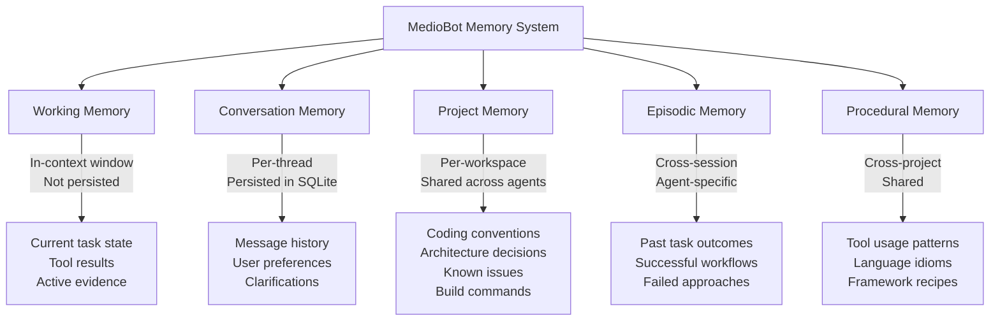

# MEMORY AND KNOWLEDGE SPEC — MedioBot V2

> **Author:** Principal AI Systems Architect (Opus Audit)
> **Date:** 2026-10-13
> **Status:** PROPOSED — Phase 7 Target
> **Infrastructure:** SQLite (existing)

---

## 1. Design Philosophy

Memories are **useful hypotheses**, not unquestionable facts. Every memory must carry:
- **Provenance**: Where did this knowledge come from?
- **Confidence**: How reliable is the source?
- **Expiry conditions**: When should this memory be invalidated?

A memory derived from observing a test pass is more reliable than one derived from an LLM inference. Both are more reliable than a user's offhand remark, which is more reliable than a recalled memory of a memory.

---

## 2. Memory Taxonomy



---

## 3. SQLite Schema

```sql
-- Memory Database
-- Location: .mediobot/cache/memory.db

PRAGMA journal_mode = WAL;
PRAGMA synchronous = NORMAL;

-- Core memory entries
CREATE TABLE IF NOT EXISTS memories (
    memory_id       TEXT PRIMARY KEY,       -- UUID
    memory_type     TEXT NOT NULL,           -- 'project' | 'episodic' | 'procedural' | 'conversation'
    agent_id        TEXT,                    -- NULL for shared memories
    workspace_id    TEXT,                    -- NULL for cross-workspace memories
    content         TEXT NOT NULL,           -- The memory content
    summary         TEXT NOT NULL,           -- Short summary for retrieval display
    source_type     TEXT NOT NULL,           -- 'tool_result' | 'user_statement' | 'agent_inference' | 'test_outcome' | 'code_observation'
    source_ref      TEXT,                    -- Reference to source (file:line, tool invocation ID, etc.)
    confidence      REAL NOT NULL DEFAULT 0.5, -- 0.0 to 1.0
    created_at      INTEGER NOT NULL DEFAULT (unixepoch()),
    accessed_at     INTEGER NOT NULL DEFAULT (unixepoch()),
    invalidated_at  INTEGER,                -- Non-null means memory is stale
    invalidation_reason TEXT,
    access_count    INTEGER NOT NULL DEFAULT 0,
    tags            TEXT NOT NULL DEFAULT '[]' -- JSON array of string tags
);

CREATE INDEX IF NOT EXISTS idx_memories_type ON memories(memory_type);
CREATE INDEX IF NOT EXISTS idx_memories_workspace ON memories(workspace_id);
CREATE INDEX IF NOT EXISTS idx_memories_agent ON memories(agent_id);
CREATE INDEX IF NOT EXISTS idx_memories_confidence ON memories(confidence DESC);

-- Full-text search over memories
CREATE VIRTUAL TABLE IF NOT EXISTS memories_fts USING fts5(
    content, summary, tags,
    content=memories,
    content_rowid=rowid,
    tokenize='porter unicode61'
);

-- Memory relationships (for A-MEM-style associative links)
CREATE TABLE IF NOT EXISTS memory_links (
    link_id         INTEGER PRIMARY KEY AUTOINCREMENT,
    source_id       TEXT NOT NULL REFERENCES memories(memory_id) ON DELETE CASCADE,
    target_id       TEXT NOT NULL REFERENCES memories(memory_id) ON DELETE CASCADE,
    relationship    TEXT NOT NULL,           -- 'supports' | 'contradicts' | 'elaborates' | 'supersedes'
    strength        REAL NOT NULL DEFAULT 0.5,
    created_at      INTEGER NOT NULL DEFAULT (unixepoch()),
    UNIQUE(source_id, target_id, relationship)
);

-- Conversation history (compact representation)
CREATE TABLE IF NOT EXISTS conversations (
    conversation_id TEXT PRIMARY KEY,
    workspace_id    TEXT,
    started_at      INTEGER NOT NULL DEFAULT (unixepoch()),
    last_active_at  INTEGER NOT NULL DEFAULT (unixepoch()),
    summary         TEXT,                   -- LLM-generated conversation summary
    turn_count      INTEGER NOT NULL DEFAULT 0
);

-- Invalidation triggers linked to file changes
CREATE TABLE IF NOT EXISTS memory_file_refs (
    ref_id          INTEGER PRIMARY KEY AUTOINCREMENT,
    memory_id       TEXT NOT NULL REFERENCES memories(memory_id) ON DELETE CASCADE,
    file_path       TEXT NOT NULL,           -- Relative path to workspace
    content_hash    TEXT NOT NULL,            -- Hash of file when memory was created
    UNIQUE(memory_id, file_path)
);

-- FTS sync triggers
CREATE TRIGGER IF NOT EXISTS memories_fts_insert AFTER INSERT ON memories BEGIN
    INSERT INTO memories_fts(rowid, content, summary, tags)
    VALUES (new.rowid, new.content, new.summary, new.tags);
END;

CREATE TRIGGER IF NOT EXISTS memories_fts_delete AFTER DELETE ON memories BEGIN
    INSERT INTO memories_fts(memories_fts, rowid, content, summary, tags)
    VALUES ('delete', old.rowid, old.content, old.summary, old.tags);
END;
```

---

## 4. TypeScript Interfaces

```typescript
// packages/memory/src/types.ts — PROPOSED

export interface MemoryEngine {
  /** Store a new memory */
  store(entry: MemoryEntry): Promise<string>; // Returns memory_id

  /** Retrieve memories relevant to a query */
  retrieve(query: MemoryQuery): Promise<ReadonlyArray<MemoryResult>>;

  /** Invalidate memories linked to changed files */
  invalidateByFile(filePath: string, newHash: string): Promise<number>; // Returns count invalidated

  /** Manually invalidate a specific memory */
  invalidate(memoryId: string, reason: string): Promise<void>;

  /** Record that a memory was accessed (for relevance ranking) */
  recordAccess(memoryId: string): Promise<void>;

  /** Get conversation summary for context injection */
  getConversationSummary(conversationId: string): Promise<string | null>;

  /** Consolidate old memories (merge redundant, prune stale) */
  consolidate(options?: ConsolidationOptions): Promise<ConsolidationReport>;

  /** Dispose resources */
  dispose(): Promise<void>;
}

export interface MemoryEntry {
  readonly type: 'project' | 'episodic' | 'procedural' | 'conversation';
  readonly agentId?: string;
  readonly workspaceId?: string;
  readonly content: string;
  readonly summary: string;
  readonly sourceType: 'tool_result' | 'user_statement' | 'agent_inference' | 'test_outcome' | 'code_observation';
  readonly sourceRef?: string;
  readonly confidence: number;
  readonly tags?: ReadonlyArray<string>;
  readonly fileRefs?: ReadonlyArray<{ path: string; hash: string }>;
}

export interface MemoryQuery {
  readonly text: string;                    // Search text
  readonly types?: ReadonlyArray<string>;   // Filter by memory type
  readonly agentId?: string;                // Filter by agent
  readonly workspaceId?: string;            // Filter by workspace
  readonly minConfidence?: number;          // Default: 0.3
  readonly maxResults?: number;             // Default: 10
  readonly includeInvalidated?: boolean;    // Default: false
}

export interface MemoryResult {
  readonly memoryId: string;
  readonly content: string;
  readonly summary: string;
  readonly confidence: number;
  readonly sourceType: string;
  readonly sourceRef: string | null;
  readonly relevanceScore: number;          // FTS5 rank
  readonly createdAt: number;
  readonly isInvalidated: boolean;
}

export interface ConsolidationOptions {
  readonly maxAge?: number;           // Seconds; memories older than this are candidates for pruning
  readonly minAccessCount?: number;   // Memories accessed fewer times are candidates
  readonly mergeThreshold?: number;   // FTS5 similarity threshold for merge candidates
}

export interface ConsolidationReport {
  readonly memoriesMerged: number;
  readonly memoriesPruned: number;
  readonly durationMs: number;
}
```

---

## 5. Confidence Model

| Source Type | Base Confidence | Rationale |
|------------|-----------------|-----------|
| `tool_result` | 0.9 | Direct tool output (file contents, command output) |
| `test_outcome` | 0.85 | Test pass/fail is deterministic |
| `code_observation` | 0.8 | AST-parsed structural fact |
| `user_statement` | 0.7 | User may be imprecise but is generally authoritative |
| `agent_inference` | 0.5 | LLM reasoning — useful but not reliable |

Confidence **decays** over time: `effective_confidence = base_confidence × (0.99 ^ days_since_creation)`

Memories are **automatically invalidated** when:
1. A referenced file's content hash changes
2. A contradicting memory with higher confidence is stored
3. Confidence decays below 0.1

---

## 6. Memory Invalidation via File Changes

When the Project Intelligence Engine detects a file change:

```
on_file_changed(file_path, new_hash):
  1. Query memory_file_refs for memories linked to file_path
  2. For each memory where stored hash ≠ new_hash:
     a. Set invalidated_at = now()
     b. Set invalidation_reason = "Referenced file changed: {file_path}"
  3. Memory remains in database but is excluded from default retrieval
  4. Agent can explicitly query invalidated memories if needed
```

---

## 7. Knowledge Sharing Between Agents

| Memory Type | Visibility |
|------------|------------|
| `project` | All agents in the workspace |
| `episodic` | Agent-specific (Cody's experiences ≠ Tester's experiences) |
| `procedural` | All agents, all workspaces (global knowledge) |
| `conversation` | Thread-scoped, accessible to Maestro for summarization |

When Maestro delegates to an agent, it includes relevant shared memories in the context:

```typescript
// Context compilation includes memory retrieval
const agentContext = {
  projectIntelligence: await pie.generateRepoMap({ maxTokens: 1500 }),
  relevantMemories: await memoryEngine.retrieve({
    text: task.objective,
    types: ['project', 'procedural'],
    workspaceId: currentWorkspace,
    maxResults: 5,
  }),
  taskObjective: task.objective,
  taskConstraints: task.constraints,
};
```

---

## 8. External Documentation Knowledge

For version-specific library documentation, the system does NOT attempt to index all docs in advance. Instead:

1. Agent encounters unfamiliar API → Weby searches for documentation
2. Weby retrieves documentation → stores as `procedural` memory with tags `['docs', 'react@18.3', ...]`
3. Future agents encountering same library → retrieve from memory before web search
4. Memory invalidated when library version changes (detected via package.json hash)

This "documentation caching" approach avoids massive upfront indexing while building a useful knowledge base over time.

---

## 9. Why Not Mem0/Letta/External Memory Services?

| Concern | Decision |
|---------|----------|
| Operational complexity | SQLite requires zero infrastructure; external services need servers, auth, billing |
| Latency | SQLite queries are sub-millisecond; external services add 50-200ms network latency |
| Privacy | All data stays local; no project code sent to third-party memory services |
| Functionality gap | FTS5 + structured queries cover 90% of retrieval needs without vector embeddings |
| Future option | If vector search proves necessary, `sqlite-vec` adds embeddings without external services |

**Decision: Use SQLite exclusively for Phase 7. Re-evaluate external services only if retrieval quality is measurably insufficient.**

---

## 10. Acceptance Criteria

| Criterion | Target |
|-----------|--------|
| Memory store latency | < 5ms per entry |
| Memory retrieval (top 10) | < 10ms |
| File-linked invalidation | < 50ms per changed file |
| Consolidation (1000 memories) | < 1 second |
| Database size (after 6 months) | < 50 MB |
| False positive retrieval rate | < 20% (measured by user relevance feedback) |
