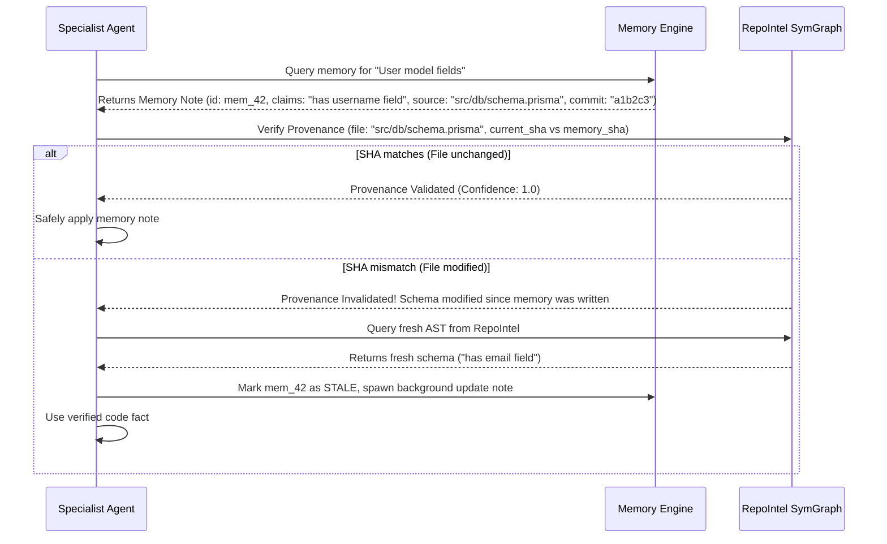

# 6. Memory and Retrieval Research: Multi-Tier Agentic Memory

> **Component:** MedioBot V2 Agentic Memory & Retrieval Subsystem  
> **Status:** Architecture Research & Specification Document  
> **Priority:** Tier 1 — Cognitive Core  
> **Authors:** AI Memory and Retrieval Researcher, Principal AI Systems Architect, Context Engineering Specialist  

---

## 1. Executive Summary & Problem Definition

Autonomous software engineering agents operating across multi-hour sessions or multi-day projects suffer from **cognitive amnesia** and **context drift**. Without structured memory:
1. Agents repeatedly ask the user to clarify architecture or conventions already discussed.
2. Agents re-attempt failed code modifications that already failed five turns ago.
3. Agents hallucinate non-existent internal utility functions because they forgot what was built previously.
4. Conversely, naive memory systems (such as unconditional vector RAG over chat logs) inject obsolete historical code snippets into the prompt, overriding current source truth and causing regressions.

This document presents a comprehensive investigation of agent memory architectures, establishes the exact definition and scientific evaluation of **MAG** versus **RAG**, and designs the **MedioBot V2 Provenance-Aware Multi-Tier Memory Engine**.

---

## 2. Demystifying MAG vs. RAG: Scientific Analysis & Definitions

A central mandate of this research is to investigate the term **MAG**, identify its precise expansion, relevant papers, and implementation, and determine whether it replaces or complements **RAG**.

### 2.1 What is MAG?
In academic and industry literature (2024–2026), **MAG** appears in two distinct, authoritative contexts:

1. **Memory-Augmented Generation (MAG):**  
   - *Foundational Concept:* While traditional RAG retrieves static documents from an external corpus via vector distance, Memory-Augmented Generation integrates a *stateful, evolving memory store* that dynamically updates with agent observations, reflections, feedback loops, and memory decay.
   - *Key Mechanisms:* Formulated in works such as *A-MEM: Agentic Memory for Long-Context Reasoning* (*arXiv:2502.12110v1*, NeurIPS 2025) and *D-MEM: Dynamic Multi-Scale Episodic Memory* (*arXiv:2603.14597v1*). Instead of returning raw chunks, MAG systems structure memories into dynamic networks (e.g., Zettelkasten-style interconnected notes with bi-directional links, tags, and confidence scores).
2. **Multi-Agent Graph (MAG):**  
   - *System Architecture:* Used in multi-agent orchestration frameworks (e.g., LangGraph, AutoGen 0.4 MAG architecture) to describe a distributed knowledge and control graph where each agent node maintains a stateful memory channel connected via typed message edges.

### 2.2 Rigorous Comparison: MAG vs. RAG vs. GraphRAG

| Dimension | Standard RAG | GraphRAG | Agentic Memory (MAG / A-MEM) |
| :--- | :--- | :--- | :--- |
| **Corpus Nature** | Static text chunks (docs, markdown, code). | Static entity-relationship knowledge graph extracted by LLMs. | Dynamic, living memory stream (experiences, failures, user habits). |
| **Indexing Process** | One-time split & embed ($O(N)$ batch embeddings). | Heavy, expensive offline LLM extraction of entities & communities. | Online, continuous ingestion; updates links and decay weights in real time. |
| **Retrieval Query** | Vector similarity (Cosine distance over Top-$K$). | Graph traversal + community summarization. | Multi-factor: Relevance $\times$ Recency $\times$ Importance $\times$ Feedback. |
| **Write/Update Cost** | Zero runtime write capability (requires re-indexing). | High batch cost to re-extract graph communities. | Extremely low ($< 5\text{ms}$ local SQLite INSERT + edge update). |
| **Failure Mode** | Returns outdated docs if files changed. | Abstract summaries miss exact variable names or line numbers. | Can propagate false memories if self-reflection is ungrounded. |
| **Primary Utility in MedioBot** | **Immutable external library documentation** (e.g., Next.js docs). | **Global codebase architectural topology** (RepoIntel SymGraph). | **Developer preferences, past bugs, task ledger, and procedural workflows**. |

**Conclusion:** **MAG does NOT replace RAG; they are complementary tiers in a unified memory hierarchy.** RAG is the library of authoritative static references; MAG is the agent's working experiential mind.

---

## 3. Evaluated Memory Frameworks: Mem0, Letta, A-MEM, and D-MEM

### 3.1 Mem0 (formerly EmbedChain)
- **Architecture:** Multi-layered memory for AI agents separating User, Session, and AI Agent memory.
- **Strengths:** Simple API, native vector database backends (Qdrant, pgvector), automatic memory extraction ("The user prefers Tailwind CSS").
- **Limitations:** Cloud-centric default, high latency when extracting memories via external LLM calls on every message, poor support for code-level syntax provenance.

### 3.2 Letta (MemGPT Evolution)
- **Architecture:** Hierarchical memory modeled on operating system memory tiers:
  - Core Memory (in-context RAM: Persona + User block, editable via tool calls).
  - Recall Memory (FIFO conversational history).
  - Archival Memory (unlimited vector storage).
- **Strengths:** Excellent self-editing primitives; agent explicitly calls `core_memory_append` and `archival_memory_search`.
- **Limitations:** High token consumption due to constant in-prompt memory schemas; single-agent focus; difficult to synchronize across 8 concurrent specialist agents.

### 3.3 A-MEM (NeurIPS 2025, *arXiv:2502.12110v1*)
- **Architecture:** Zettelkasten-inspired Agentic Memory. When a new memory note is formed:
  1. It generates atomic notes with keywords, context, and semantic links.
  2. It dynamically links to related past notes via bidirectional graph edges.
  3. It continuously updates and consolidates related notes into higher-order conceptual rules.
- **Strengths:** High retrieval precision for long-horizon problem solving (+24.8% over standard RAG on complex agent benchmarks); prevents context fragmentation.

### 3.4 D-MEM & Jev-Mem (2026, *arXiv:2603.14597v1*, *arXiv:2609.23986v1*)
- **Architecture:** Dual-speed cognitive memory. Fast episodic cache (System 1) buffers immediate tool observations; slow memory consolidator (System 2) asynchronously distills verified patterns into durable procedural memory during idle cycles.

---

## 4. The MedioBot V2 Memory Hierarchy

MedioBot V2 adopts a **4-tier memory hierarchy** optimized for local execution on macOS and Windows, fully backed by an embedded SQLite database (`.mediobot/cache/memory.db`).

```mermaid
flowchart TD
    subgraph Tier 0: In-Context Working Memory
        ActiveContext[Prompt Context Window: Turn Budget < 12k tokens]
        ActiveContext --> SubtaskFocus[Active Subtask Objective]
        ActiveContext --> WorkingFiles[Active File Diff Dumps]
    end

    subgraph Tier 1: Task Ledger & Episodic Memory
        TaskLedger[Task Ledger: Completed Steps, Errors, Retries]
        ToolResults[Tool Execution Evidence & Raw Shell Outputs]
    end

    subgraph Tier 2: Procedural & Semantic Memory
        A_MEM[A-MEM Zettelkasten Network: Solution Patterns]
        Rules[Project Rules & Coding Conventions]
        Failures[Failure Invariant Index: What Not To Do]
    end

    subgraph Tier 3: External Knowledge & Static RAG
        RepoMap[RepoIntel SymGraph - Code Truth]
        DocStore[Version-Aware Library Documentation]
    end

    Tier 0 <-->|Dynamic Injection| Tier 1
    Tier 1 -->|Async Consolidation| Tier 2
    Tier 2 <-->|Provenance Check| Tier 3
```

### 4.1 Tier 0: In-Context Working Memory (Task-Scoped)
- **Scope:** Ephemeral, lives only for the duration of a single agent subtask turn.
- **Contents:** The assigned subtask goal, the personalized RepoMap snippet, active file diffs, and immediate tool results.
- **Lifecycle:** Destroyed upon subtask completion; key outcomes are summarized and written to Tier 1.

### 4.2 Tier 1: Episodic Memory & Task Ledger (Session-Scoped)
- **Scope:** The entire user session / sprint.
- **Contents:** 
  - Chronological execution log: what files were changed, which tests were run, and what errors were encountered.
  - Cross-agent evidence ledger: Maestro and peer specialists can inspect what Cody did three minutes ago.
- **Storage:** SQLite `session_episodes` table. Fast append-only, zero serialization lag.

### 4.3 Tier 2: Semantic & Procedural Team Memory (Project-Scoped)
- **Scope:** Long-term memory across sessions for the specific repository.
- **Contents:**
  - **User & Project Conventions:** "Use `pnpm` exclusively; never use `npm` or `yarn`." "API errors must return `{ error: string, code: number }`."
  - **Failure Memory (Anti-Patterns):** "Do not upgrade `package-x` to v4 because it breaks ESM imports in this build setup."
  - **Verified Solution Blueprints:** How authentication mocking is configured in the test suite.
- **Storage:** SQLite with vector embeddings + A-MEM graph links.

### 4.4 Tier 3: Authoritative Reference (External & Repo Truth)
- **Scope:** Read-only reference libraries and live code state.
- **Contents:**
  - Active codebase AST and symbol graphs (from Deliverable 5: RepoIntel).
  - Version-pinned documentation libraries (e.g., React 19 docs, Prisma 6 docs).

---

## 5. Provenance-Aware Memory: The "Code Truth Invariant"

A critical failure of naive memory systems is **memory hallucination overriding code reality**. For example:
- *Memory Entry (from 2 weeks ago):* "The user model has a `username` column."
- *Current Source Code (modified yesterday):* The migration renamed `username` to `email`.
- *Catastrophic Agent Behavior:* The agent trusts the memory, writes code using `user.username`, and breaks the build.

### 5.1 The Iron Invariant
> **THE CODE IS THE SINGLE SOURCE OF TRUTH.**  
> Memory entries are historical hypotheses. Source code is verified physical reality. Memory must NEVER override contradictory AST or filesystem facts.

### 5.2 Verification & Invalidation Protocol


---

## 6. SQLite-Native Storage Architecture

To avoid heavy external database dependencies (like Pinecone, Milvus, or external Docker Postgres instances), MedioBot V2 implements memory inside a local SQLite database using native extensions:
- **`sqlite-vec` / `sqlite-vss`:** Fast, embedded vector search directly inside SQLite.
- **`FTS5`:** Full-text BM25 search over memory contents and tags.
- **Relational Tables:** Fast graph traversal over Zettelkasten links.

### 6.1 Database Schema
```sql
-- Memory Note Store
CREATE TABLE memory_notes (
    id TEXT PRIMARY KEY,
    workspace_id TEXT NOT NULL,
    memory_type TEXT NOT NULL, -- 'CONVENTION' | 'SOLUTION' | 'FAILURE_RULE' | 'EPISODIC'
    title TEXT NOT NULL,
    content TEXT NOT NULL,
    importance_score REAL NOT NULL DEFAULT 1.0, -- 0.0 to 2.0
    access_count INTEGER NOT NULL DEFAULT 1,
    last_accessed_at INTEGER NOT NULL,
    created_at INTEGER NOT NULL,
    -- Provenance metadata
    source_file TEXT,
    source_commit_sha TEXT,
    source_turn_id TEXT,
    status TEXT NOT NULL DEFAULT 'ACTIVE' -- 'ACTIVE' | 'STALE' | 'INVALIDATED'
);

-- Bidirectional Graph Links (A-MEM Network)
CREATE TABLE memory_links (
    source_note_id TEXT NOT NULL,
    target_note_id TEXT NOT NULL,
    relationship TEXT NOT NULL, -- 'relates_to' | 'supersedes' | 'caused_by' | 'mitigates'
    weight REAL NOT NULL DEFAULT 1.0,
    PRIMARY KEY (source_note_id, target_note_id),
    FOREIGN KEY (source_note_id) REFERENCES memory_notes(id) ON DELETE CASCADE,
    FOREIGN KEY (target_note_id) REFERENCES memory_notes(id) ON DELETE CASCADE
);

-- Fast Vector Embedding Virtual Table
CREATE VIRTUAL TABLE memory_vectors USING vec0(
    note_id TEXT PRIMARY KEY,
    embedding FLOAT[384] -- 384-dimensional embeddings (e.g. all-MiniLM-L6-v2)
);
```

---

## 7. Memory Lifecycle: Decay, Consolidation, and Eviction

Without an eviction and consolidation policy, memory databases grow indefinitely, degrading retrieval speed and polluting prompts with irrelevant trivia.

### 7.1 Mathematical Decay Model
Memory note retrieval score is calculated using an Ebbinghaus-inspired retention formula:
$$Score(N) = \left( \lambda_{sim} \cdot Sim(q, N) + \lambda_{fts} \cdot BM25(q, N) \right) \cdot Importance(N) \cdot e^{-\frac{\Delta t}{\tau \cdot (1 + \ln(AccessCount))}}$$
- $\Delta t$: Time elapsed since last access.
- $\tau$: Half-life decay constant (e.g., 7 days for general memories, 30 days for conventions).
- As an agent repeatedly accesses and reinforces a memory ($AccessCount$), its decay rate slows exponentially.

### 7.2 Asynchronous Consolidation (System 2 Worker)
During idle time (when no agent turns are executing):
1. A lightweight background thread scans active episodic memories.
2. If multiple episodic memories describe the same recurring error (e.g., "Port 3000 already in use across 3 turns"), the consolidator synthesizes an atomic **Procedural Rule**: "Check for active port processes before spawning the dev server."
3. Redundant episodic notes are archived, keeping the active working memory lean and sharp.

---

## 8. Summary of Capabilities & Transition to Concurrency

| Capability | Current MedioBot V2 | Proposed MedioBot V2 Memory Subsystem |
| :--- | :--- | :--- |
| **Persistence** | Chat messages only in SQLite `sessions.db`. | Multi-tier: Ephemeral, Session, Project, and Team Zettelkasten network. |
| **Code Grounding** | None; easily hallucinates past code states. | Strict Code Truth Invariant with SHA-256 provenance validation. |
| **Retrieval Speed** | N/A (no memory search). | $< 5\text{ms}$ local SQLite hybrid vector + FTS5 retrieval. |
| **External Dependencies** | None. | Zero external dependencies; 100% embedded SQLite + `sqlite-vec`. |

Having established deep repository understanding (Deliverable 5) and structured provenance-aware memory (Deliverable 6), we now confront the critical engineering challenge of **Deliverable 7: Parallel Execution and Conflict Management**—how 4 to 8 agents can work concurrently without colliding on files, processes, or git states.
