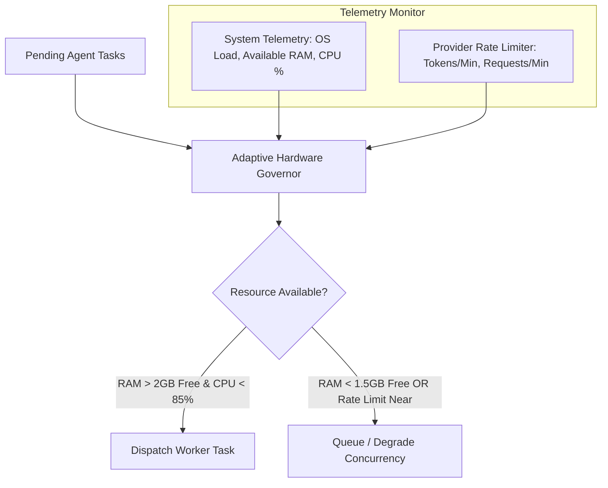
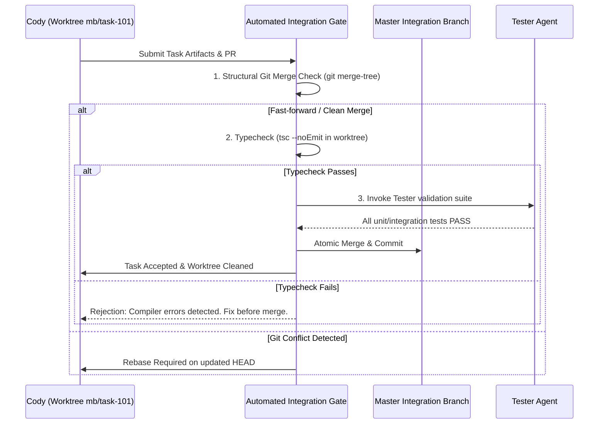

# 7. Parallel Execution and Conflict Management: Concurrent Multi-Agent Isolation

> **Component:** MedioBot V2 Concurrency & Workspace Isolation Engine  
> **Status:** Architecture Research & Specification Document  
> **Priority:** Tier 1 — Operational Safety & Scale  
> **Authors:** Distributed Systems Architect, Performance Engineer, Security & Sandboxing Architect  

---

## 1. Executive Summary & Problem Definition

To achieve the vision of an autonomous Agile engineering team where **4 to 8 specialist agents** collaborate simultaneously, MedioBot must solve the fundamental hazard of **concurrent mutability**.

If eight agents execute in an uncoordinated, shared directory:
1. **Write Races & File Overwrites:** Cody implements an API in `routes/auth.ts` while Dessy adjusts styling in `routes/auth.ts`, silently clobbering each other's changes.
2. **Test Pollution & Port Collisions:** Cody runs `npm test` while Tester runs integration tests, both binding to port 3000 and writing to `./coverage`, triggering spurious test failures.
3. **Dirty Working Tree Chaos:** Uncommitted code from Agent A breaks the build for Agent B, causing Agent B to waste turns debugging unrelated breakage.
4. **Hardware Saturation:** 8 separate Node.js processes, each running TypeScript type-checks and bundling tasks, will spike RAM beyond 16 GB and choke CPU cores on a laptop.

This document designs the **Worktree Isolation & Topological Wave Engine (WIM-TWE)** for MedioBot V2. It synthesizes architectural patterns from **SPOQ** (*arXiv:2606.03115v1*, topological wave execution), **Agyn** (*arXiv:2602.01465v2*, isolated sandboxes), and native Git worktrees to guarantee safe, deterministic, zero-overwrite multi-agent concurrency.

---

## 2. Comparative Analysis of Isolation Mechanisms

We evaluated five architectural patterns for multi-agent workspace concurrency:

| Isolation Strategy | Safety & Conflict Prevention | Disk & RAM Overhead | Merge Complexity | Tool Compatibility | Decision for MedioBot |
| :--- | :--- | :--- | :--- | :--- | :--- |
| **1. Shared Directory + File Locking** | Low. Lock contention halts parallel agents. Lock deadlocks frequent. | Zero disk overhead. | N/A (single branch). | High (native path). | ❌ **Rejected** (Lacks test isolation; lock contention defeats parallelism). |
| **2. Optimistic Concurrency (AST Patch Merging)** | Medium. Frequent merge conflicts if agents touch nearby lines. | Zero disk overhead. | Very High (requires complex 3-way AST merge). | High. | ❌ **Rejected** (Non-deterministic merge failures; breaks code semantics). |
| **3. Full Repository Clones (`git clone`)** | High. Complete isolation. | Catastrophic (10x disk space, duplicate `node_modules` of 800 MB each). | Low (`git merge`). | High. | ❌ **Rejected** (Exhausts laptop disk and RAM on 8-agent pods). |
| **4. Docker / Container Sandboxes** | High. Absolute filesystem & network isolation. | Very High (requires Docker daemon, high VM overhead on macOS/Win). | Medium. | Low (poor local file sync, tool latency). | ❌ **Rejected** (Too heavyweight for standard developer laptops). |
| **5. Isolated Git Worktrees (`git worktree`)** | **Very High.** Complete filesystem isolation per subtask. | **Extremely Low.** Shares single `.git` object database; single `node_modules` via symlinks/hardlinks. | **Automated.** Standard Git branch merges validated by automated test gates. | **Native.** Tools run against physical local paths. | ✅ **SELECTED AS PRIMARY ARCHITECTURE** |

---

## 3. The Recommended Architecture: Git Worktree Isolation Manager (WIM)

`git worktree` is a native, production-grade Git feature designed specifically for checking out multiple branches of the same repository simultaneously into separate directory trees.

```mermaid
flowchart TD
    RepoRoot[Master Repository: /project-root] --> GitStore[.git Object Store - Single Source of Truth]
    
    subgraph WIM: Ephemeral Worktrees
        GitStore --> WT_Cody["/project-root/.mediobot/worktrees/task-101-auth<br>(Branch: mb/task-101-auth)<br>Assigned: Cody"]
        GitStore --> WT_Dessy["/project-root/.mediobot/worktrees/task-102-ui<br>(Branch: mb/task-102-ui)<br>Assigned: Dessy"]
        GitStore --> WT_Tester["/project-root/.mediobot/worktrees/task-103-qa<br>(Branch: mb/task-103-qa)<br>Assigned: Tester"]
    end

    subgraph Dependency Management
        NodeModules[/project-root/node_modules] -.->|Symlink / Hardlink| WT_Cody
        NodeModules -.->|Symlink / Hardlink| WT_Dessy
        NodeModules -.->|Symlink / Hardlink| WT_Tester
    end

    subgraph Merge & Verification Gate
        WT_Cody -->|Task Complete| PR_Gate[Automated Integration Gate]
        PR_Gate --> FastForwardCheck{Clean Fast-Forward Merge?}
        FastForwardCheck -->|Yes| TestRun[Run Automated Verification Suite]
        TestRun -->|Pass| CommitMain[Merge into main / active branch]
        FastForwardCheck -->|Conflict| RebaseAgent[Maestro prompts Cody to resolve rebase]
    end
```

### 3.1 Worktree Lifecycle Specification
1. **Creation:** When Maestro dispatches a parallel subtask to an agent (e.g., `task-101` to Cody):
   ```bash
   git worktree add -b mb/task-101-auth .mediobot/worktrees/task-101-auth HEAD
   ```
2. **Zero-Copy Dependency Sharing:**
   - In Node.js projects, running `pnpm install` in 8 separate directories would consume 6+ GB of disk and take minutes.
   - WIM creates a symlink from `.mediobot/worktrees/task-101-auth/node_modules` pointing back to the root `node_modules`. (On Windows where symlinks require privileges, junction points or pnpm's content-addressable hardlink store are utilized).
3. **Execution:** Cody operates with tools (`read_file`, `write_to_file`, `run_command`) strictly scoped to `.mediobot/worktrees/task-101-auth`. Cody cannot see or corrupt uncommitted edits from Dessy.
4. **Validation & Integration:** Once Cody finishes, the branch is committed locally and passed to the Integration Gate.
5. **Teardown & Cleanup:** Once merged, the worktree is cleanly pruned:
   ```bash
   git worktree remove --force .mediobot/worktrees/task-101-auth
   git branch -D mb/task-101-auth
   ```

---

## 4. Scheduling & Dependency Resolution: Topological Wave Execution (SPOQ Pattern)

Even with isolated worktrees, tasks with hard data dependencies cannot run arbitrarily in parallel. For example, Tester cannot validate the authentication endpoint before Cody creates the routes.

MedioBot V2 adopts the **Topological Wave Execution (TWE)** model established in **SPOQ** (*arXiv:2606.03115v1*).

```mermaid
flowchart LR
    subgraph Wave 0: Research & Scaffolding
        T1[Doc: Retrieve OAuth2 Spec]
        T2[Dessy: Design Auth Modal Figma Specs]
    end

    subgraph Wave 1: Independent Implementation
        T3[Cody: Implement Backend Auth Service]
        T4[Cody-UI: Implement Auth Form Components]
    end

    subgraph Wave 2: Integration & Verification
        T5[Tester: Run End-to-End Auth Test Suite]
        T6[Doc: Generate API Documentation]
    end

    T1 & T2 -->|Wave 0 Barrier Resolved| Wave 1
    T3 & T4 -->|Wave 1 Barrier Merged| Wave 2
```

### 4.1 Dependency-Aware DAG Formulation
1. Maestro decomposes a complex user goal into a Directed Acyclic Graph (DAG) $G = (T, E)$, where $T$ are subtasks and directed edges $E = (u, v)$ signify that task $v$ requires the completed artifact of task $u$.
2. **Topological Partitioning into Waves:**
   The DAG is partitioned into ordered execution waves $W_0, W_1, \dots, W_k$ such that for any edge $(u, v) \in E$, if $u \in W_i$ and $v \in W_j$, then $i < j$.
3. **Wave Execution Invariant:**
   - All tasks within wave $W_i$ have **zero mutual dependencies** and are dispatched **concurrently** across isolated worktrees.
   - Wave $W_{i+1}$ does not begin until all tasks in wave $W_i$ pass the Automated Integration Gate and merge into the common integration branch.

---

## 5. File Ownership & Dynamic Reservation Matrix

What if two tasks in the same wave intend to touch overlapping files? To prevent merge conflicts at the end of a wave, MedioBot V2 implements a **Predictive File Reservation Matrix**:

```typescript
export interface TaskContract {
  taskId: string;
  assignedAgent: string;
  targetFiles: string[];       // Files the agent is authorized to write
  readOnlyFiles: string[];     // Files the agent can read
  estimatedTokens: number;
}
```

1. **Conflict Detection at Dispatch:**  
   Before dispatching a wave, the Scheduler checks for pairwise intersection:
   $$\text{targetFiles}(T_a) \cap \text{targetFiles}(T_b) = \emptyset \quad \forall T_a, T_b \in W_i$$
2. **Resolution Strategy:**
   - If intersection is empty: Both tasks run in parallel in separate worktrees.
   - If intersection is non-empty (e.g., both need to edit `src/routes.ts`):
     - **Option A (Sub-chunking):** If edits are non-overlapping functions, allow with designated merge priority.
     - **Option B (Wave Splitting):** Maestro splits the tasks into sequential sub-waves, scheduling the upstream dependency first.

---

## 6. Hardware & Resource Protection: Throttling for Mac & Windows

Running 8 concurrent agents must not lock up the user's workstation. The Concurrency Scheduler implements an **Adaptive Hardware Governor**:



### 6.1 Hardware Tier Profiles
| Machine Profile | Memory Budget for MedioBot | Max Concurrent Agents | Worktree Limit | Parser Workers |
| :--- | :--- | :--- | :--- | :--- |
| **Entry (8 GB RAM)** | $\le 1.8\text{ GB}$ total | **2 agents** (Maestro + 1 Specialist) | 1 worktree | 1 background worker |
| **Standard (16 GB RAM)** | $\le 3.5\text{ GB}$ total | **4 agents** concurrently | 3 worktrees | 2 background workers |
| **Pro / Studio (32+ GB RAM)**| $\le 7.0\text{ GB}$ total | **8+ agents** concurrently | 6 worktrees | 4 background workers |

### 6.2 Port & Ephemeral Service Allocation
When running tests or preview dev servers concurrently:
- Each worktree receives an assigned, non-conflicting port offset:
  - Base: `3000`
  - Agent 1: `3011`, Agent 2: `3012`, Agent 3: `3013`, etc.
- Database test fixtures utilize task-scoped SQLite databases (`test_task101.db`) or task-prefixed schema namespaces to prevent fixture mutation collisions.

---

## 7. The Automated Integration Gate (Merge & Verification)

When an agent signals task completion, its worktree does not merge automatically. It must pass the **Dual Validation Gate**:



### 7.1 Rollback Guarantee
If an integrated task causes a regression in subsequent wave tests:
- Every wave completion creates an atomic Git checkpoint tag: `mb-checkpoint-wave-N`.
- Rolling back takes `< 1` second: `git reset --hard mb-checkpoint-wave-(N-1)`.
- No uncommitted or half-baked state is ever left in the user's primary working directory.

---

## 8. Summary & Transition to Specialist Agent Design

The Worktree Isolation & Topological Wave Engine provides:
- **Zero file overwrites:** 100% physically isolated worktrees for concurrent write tasks.
- **Minimal overhead:** Shared `.git` object store and symlinked dependencies require $< 50\text{ MB}$ extra disk per worktree.
- **Hardware safety:** Adaptive concurrency scaling for 8 GB, 16 GB, and 32 GB machines.
- **Deterministic rollbacks:** Every wave is a verified Git checkpoint.

Next, in **Deliverable 8: Specialist Agent Design**, we detail the personas, tool boundaries, prompt contracts, and domain skillsets of Maestro, Cody, Tester, Doc, Dessy, Weby, and Scraapy.
