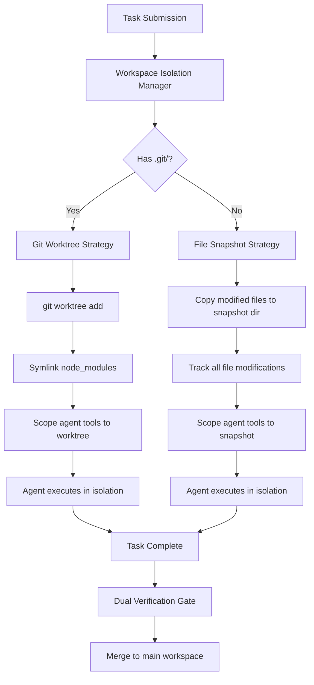
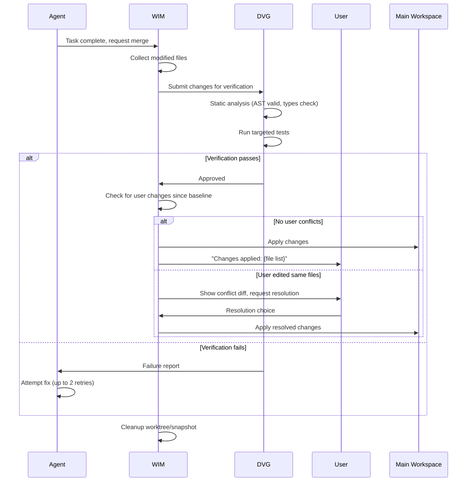

# PARALLEL EXECUTION SPEC — MedioBot V2

> **Author:** Principal AI Systems Architect (Opus Audit)
> **Date:** 2026-10-13
> **Status:** PROPOSED — Safe Multi-Agent Code Modification
> **Affects:** New `packages/isolation/` module

---

## 1. Problem Statement

Multiple AI agents writing to the same codebase simultaneously creates risks:
- **File collisions**: Two agents editing the same file
- **Semantic conflicts**: Agents editing related files in incompatible ways
- **Build breaks**: Agent A's changes break Agent B's assumptions
- **User change loss**: Agents overwrite uncommitted user work
- **Non-Git projects**: No branching mechanism available

---

## 2. Workspace Isolation Manager (WIM)

### 2.1 Dual Strategy Architecture



### 2.2 Git Worktree Strategy

```typescript
// PROPOSED — Git worktree management
export interface GitWorktreeStrategy {
  /** Create a worktree for a task */
  create(taskId: TaskId, baseBranch?: string): Promise<WorktreeInfo>;

  /** List active worktrees */
  list(): Promise<ReadonlyArray<WorktreeInfo>>;

  /** Merge worktree changes back to main */
  merge(taskId: TaskId, strategy: MergeStrategy): Promise<MergeResult>;

  /** Clean up worktree after task completion */
  cleanup(taskId: TaskId): Promise<void>;

  /** Stash user's uncommitted changes before parallel work */
  protectUserChanges(): Promise<StashInfo | null>;

  /** Restore user's uncommitted changes after parallel work */
  restoreUserChanges(stash: StashInfo): Promise<void>;
}

export interface WorktreeInfo {
  readonly taskId: TaskId;
  readonly path: string;           // Absolute path to worktree directory
  readonly branch: string;         // Task-scoped branch name
  readonly baseBranch: string;     // Branch this was created from
  readonly createdAt: number;
}

export type MergeStrategy =
  | { readonly type: 'fast-forward' }    // Safe, no conflicts possible
  | { readonly type: 'three-way' }       // Standard merge
  | { readonly type: 'patch' };          // Apply as patch (most flexible)

export type MergeResult =
  | { readonly success: true; readonly filesChanged: ReadonlyArray<string> }
  | { readonly success: false; readonly conflicts: ReadonlyArray<string>; readonly patchPath: string };
```

### 2.3 File Snapshot Strategy (Non-Git)

```typescript
// PROPOSED — File snapshot for non-Git projects
export interface FileSnapshotStrategy {
  /** Create a snapshot workspace for a task */
  create(taskId: TaskId): Promise<SnapshotInfo>;

  /** Apply snapshot changes back to main workspace */
  apply(taskId: TaskId): Promise<ApplyResult>;

  /** Clean up snapshot directory */
  cleanup(taskId: TaskId): Promise<void>;
}

export interface SnapshotInfo {
  readonly taskId: TaskId;
  readonly snapshotDir: string;     // .mediobot/snapshots/{taskId}/
  readonly baselineHashes: Map<string, string>; // file path → SHA-256 at snapshot time
  readonly createdAt: number;
}

// Snapshot strategy:
// 1. Agent reads are redirected: check snapshot dir first, fall back to main workspace
// 2. Agent writes go to snapshot dir only
// 3. On apply: for each modified file in snapshot, check if main workspace file
//    has changed since baseline. If yes → conflict. If no → copy snapshot → main.
```

---

## 3. Git Worktree Limitations and Mitigations

| Limitation | Impact | Mitigation |
|-----------|--------|------------|
| Worktrees share `.git/` directory | Lock contention on concurrent git operations | Serialize git operations through a command queue |
| Cannot check out same branch in two worktrees | Prevents two agents from working on `main` | Use unique task-scoped branch names: `mediobot/task-{id}` |
| `node_modules` not shared | Each worktree would need its own install | Symlink `node_modules` from main workspace |
| Build artifacts in wrong location | Build output paths may be hardcoded | Override output paths via environment variables where possible |
| Worktrees on Windows | `git worktree` works but symlinks require admin | Use directory junctions (`mklink /J`) instead of symlinks on Windows |
| Stale worktrees after crashes | Orphaned directories and branches | Cleanup on startup: `git worktree prune` + branch cleanup |

---

## 4. File Ownership and Conflict Detection

### 4.1 Static Conflict Prevention (Pre-execution)

Before a task starts, its `fileOwnership` list is validated:

```
for each file in task.fileOwnership:
  if fileOwnershipRegistry.owner(file) is not null:
    CONFLICT — defer task until owning task completes
```

### 4.2 Dynamic Conflict Detection (During execution)

Agents may discover they need to modify files not in their original ownership list:

```typescript
// Tool wrapper for file writes
async function scopedWriteFile(taskId: TaskId, filePath: string, content: string): Promise<WriteResult> {
  // Check if this file is already owned by another task
  const currentOwner = fileOwnershipRegistry.owner(filePath);
  if (currentOwner && currentOwner !== taskId) {
    return { success: false, reason: 'file-owned-by-another-task', owner: currentOwner };
  }

  // Dynamically claim ownership if not already claimed
  if (!currentOwner) {
    const claim = fileOwnershipRegistry.claim(taskId, [filePath]);
    if (!claim.success) {
      return { success: false, reason: 'claim-failed', conflicts: claim.conflicts };
    }
  }

  // Proceed with write in isolated workspace
  return await performWrite(filePath, content);
}
```

### 4.3 Semantic Conflict Detection (Post-execution)

After agent tasks complete, before merging:

1. **Import graph check**: Did Agent A modify a file that Agent B's modified files import?
2. **Type signature check**: Did any shared interface/type change between worktrees?
3. **Test verification**: Run full test suite against merged result before committing

---

## 5. Protecting User Changes

**CRITICAL REQUIREMENT**: No agent may overwrite uncommitted user changes without authorization.

### 5.1 Pre-Parallel Protection

```
Before starting parallel agent work:
  1. Check for uncommitted changes (git status / file hash comparison)
  2. If changes exist:
     a. git stash push -m "mediobot-protect-{timestamp}" (Git projects)
     b. Copy changed files to .mediobot/user-backup/ (non-Git projects)
  3. Record the stash/backup reference
  4. After all agent work completes and merges:
     a. Restore user changes
     b. If conflicts with agent changes: present diff to user for resolution
```

### 5.2 User Change Monitoring

During parallel execution, if the user edits files:

```
File watcher detects user edit to file F:
  1. If F is owned by a running task:
     a. Pause the task (if possible)
     b. Notify user: "Agent is also modifying this file"
     c. User chooses: let agent continue, or cancel agent's task
  2. If F is not owned by any task:
     a. Allow edit (no conflict)
     b. Update baseline hashes for merge detection
```

---

## 6. Integration and Merge Protocol



---

## 7. Performance Requirements

| Metric | Target |
|--------|--------|
| Worktree creation | < 500ms (including symlinks) |
| Worktree cleanup | < 200ms |
| File snapshot creation | < 1s for 100 modified files |
| Merge (fast-forward) | < 100ms |
| Merge (three-way, no conflicts) | < 500ms |
| Conflict detection | < 200ms |
| User change stash/restore | < 300ms |

---

## 8. Acceptance Criteria

| Criterion | Test |
|-----------|------|
| Two agents modify different files simultaneously | Both merge cleanly |
| Two agents attempt same file | Second agent blocked by file ownership |
| Agent crashes mid-task | Worktree cleaned up, no orphaned branches |
| User has uncommitted changes | Changes preserved through parallel work |
| Non-Git project | File snapshot strategy activated, merge works |
| Windows compatibility | Directory junctions work, no symlink admin required |
