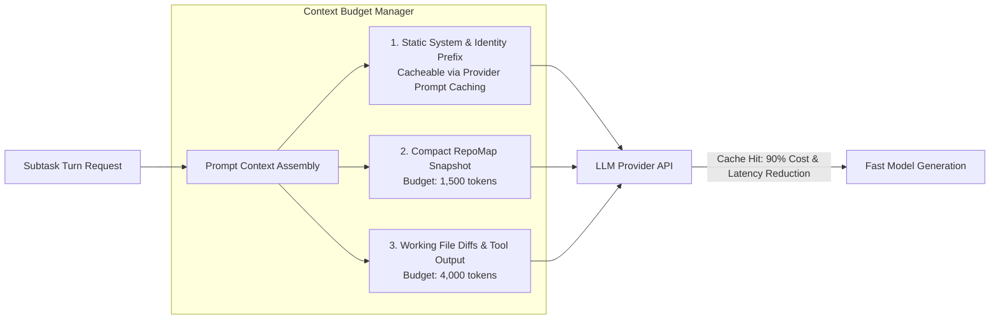

# 11. Performance Optimization: macOS, Windows, and Cross-Platform Hardware Scaling

> **Component:** MedioBot V2 System Performance & Hardware Governor  
> **Status:** Architecture Research & Specification Document  
> **Priority:** Tier 1 — Responsiveness & Resource Efficiency  
> **Authors:** Performance Engineer (macOS/Windows), Distributed Systems Architect, Principal AI Systems Architect  

---

## 1. Executive Summary & Problem Definition

A multi-agent development environment running 4 to 8 specialist agents must coexist with the developer's IDE, browser, compiler, and local dev servers on a single personal workstation.

The fundamental failure mode of unoptimized multi-agent frameworks (such as running 8 distinct Python or Node.js Docker containers) is **resource exhaustion**:
1. Spawning 8 full Node.js runtimes consumes $8 \times 250\text{ MB} = 2.0\text{ GB}$ of RAM just for baseline runtimes before processing a single token.
2. Concurrent AST indexing and TypeScript typecheck invocations choke CPU cores, sending laptop fans spinning and causing thermal throttling.
3. On Windows, file-locking semantics (`EBUSY` / `EPERM`) frequently crash tools attempting to delete or overwrite active files.
4. On macOS, running un-throttled processes exhausts memory pressure, forcing swapping to disk and freezing the UI.

This document establishes the **MedioBot V2 High-Performance Architecture**. Grounded in lightweight logical actors, shared in-process runtimes, platform-specific OS primitives (macOS ARM64 GCD & Windows I/O Completion Ports), and strict hardware tier budgeting (8 GB, 16 GB, and 32 GB), it guarantees maximum responsiveness with a minimal hardware footprint.

---

## 2. In-Process Logical Actors vs. Heavyweight Separate Processes

A pivotal design decision is how specialist agents (Maestro, Cody, Tester, Doc, Dessy, etc.) are physically scheduled in the operating system.

```mermaid
flowchart TD
    subgraph Anti-Pattern: Heavyweight OS Processes
        Process1[Process: Cody - 350MB Node]
        Process2[Process: Tester - 350MB Node]
        Process3[Process: Dessy - 350MB Node]
        Process4[Process: Doc - 350MB Node]
        IPC1[Inter-Process IPC: Slow JSON Socket Serialization]
        Process1 & Process2 & Process3 & Process4 <--> IPC1
    end

    subgraph Recommended: In-Process Logical Actors
        NodeRuntime[Single Unified Node.js Engine: ~85MB Base RAM]
        NodeRuntime --> EventLoop[Single V8 Event Loop / Async Dispatcher]
        EventLoop --> Actor_Maestro[Actor: Maestro (State Machine)]
        EventLoop --> Actor_Cody[Actor: Cody (State Machine)]
        EventLoop --> Actor_Tester[Actor: Tester (State Machine)]
        EventLoop --> Actor_Doc[Actor: Doc (State Machine)]
        
        NodeRuntime --> SharedCache[(Shared In-Memory SQLite SymGraph / Memory DB)]
        Actor_Maestro & Actor_Cody & Actor_Tester & Actor_Doc <-->|Zero-Copy In-Memory| SharedCache
        
        NodeRuntime --> WorkerPool[Worker Thread Pool: 2-4 threads for heavy AST parsing / CPU tasks]
    end
```

| Dimension | Separate OS Processes | In-Process Logical Actors (MedioBot V2) | Gain / Efficiency |
| :--- | :--- | :--- | :--- |
| **Idle RAM Footprint (8 Agents)** | $\sim 2,400\text{ MB}$ to $3,200\text{ MB}$ | $\sim 110\text{ MB}$ to $180\text{ MB}$ | **93% RAM Reduction** |
| **Inter-Agent Message Latency** | $15\text{ms} - 45\text{ms}$ (IPC sockets / pipes) | $< 0.05\text{ms}$ (V8 in-memory function call) | **300x Faster Communication** |
| **Shared Index Access** | Must duplicate or query over network | Single zero-copy SQLite connection in WAL mode | Zero duplicate parsing |
| **Process Crash Isolation** | High | Managed via actor supervision trees | Equivalent safety with lower cost |

**Verdict:** Specialist agents in MedioBot V2 are **logical state-machine actors** executing within a single high-performance Node.js runtime. Heavy computational tasks (Tree-sitter AST parsing, large file hashing) are offloaded to an elastic pool of **Worker Threads** capped to physical CPU cores.

---

## 3. Hardware Tier Profiles: 8 GB, 16 GB, and 32 GB Scaling

MedioBot V2 dynamically detects system capabilities at startup and applies tailored resource ceilings:

```typescript
export interface SystemHardwareProfile {
  tier: 'ENTRY_8GB' | 'STANDARD_16GB' | 'PRO_32GB';
  maxConcurrentActiveAgents: number;
  maxActiveWorktrees: number;
  parserWorkerThreads: number;
  contextCacheBudgetMB: number;
  enableAggressiveGc: boolean;
}
```

### 3.1 Profile Configurations

#### Tier 1: Entry Profile (8 GB RAM Machines, e.g., Base MacBook M1/M2 or Budget Windows PC)
- **Total Memory Allocation for MedioBot:** $\le 1.5\text{ GB}$ ceiling.
- **Agent Concurrency:** Max **2 active agents** (Maestro + 1 Specialist executing at any instant; others remain paused in serialized state).
- **Worktree Limit:** 1 active worktree. Tasks execute sequentially or in small waves.
- **Worker Threads:** 1 dedicated parser thread.
- **Context Caching:** Aggressive prompt pruning; in-memory cache evicted every 3 turns.
- **Garbage Collection:** Explicit `v8.setFlagsFromString('--optimize_for_size')` and periodic manual trigger of idle GC.

#### Tier 2: Standard Profile (16 GB RAM Machines — The Developer Standard)
- **Total Memory Allocation:** $\le 3.5\text{ GB}$ ceiling.
- **Agent Concurrency:** **4 active agents** running concurrently.
- **Worktree Limit:** Up to 3 active worktrees simultaneously.
- **Worker Threads:** 2 worker threads.
- **Context Caching:** Standard RepoMap caching; maintains AST index in memory.

#### Tier 3: Pro / Studio Profile (32+ GB RAM Machines)
- **Total Memory Allocation:** $\le 7.0\text{ GB}$ ceiling.
- **Agent Concurrency:** **8+ active agents** concurrently.
- **Worktree Limit:** Up to 6 active worktrees simultaneously.
- **Worker Threads:** 4 worker threads.
- **Context Caching:** Full persistent in-memory AST and vector index; parallel typechecking enabled.

---

## 4. Platform-Specific Engineering: macOS vs. Windows

Cross-platform parity requires engineering specifically for the differing kernel primitives of macOS (Darwin) and Windows (NT).

### 4.1 macOS (Apple Silicon ARM64) Optimization
- **Native File Events (`FSEvents`):** Utilizes macOS kernel `FSEvents` API rather than polling. Catches thousands of file system modifications in a single kernel event with $< 0.1\%$ CPU usage.
- **Quality of Service (QoS) Thread Scheduling:**
  - UI Server & SSE Streams: Bound to `UserInteractive` QoS.
  - LLM Inference & Actor Coordination: Bound to `UserInitiated` QoS.
  - Background Tree-sitter Indexing & Memory Consolidation: Bound to `Utility` / `Background` QoS, ensuring background tasks run strictly on Apple Silicon **Efficiency cores (E-cores)** without robbing performance from user IDE keystrokes.
- **Memory Pressure Monitoring:** Listens to `dispatch_source_create(DISPATCH_SOURCE_TYPE_MEMORYPRESSURE)`. If macOS enters warning pressure, MedioBot automatically shrinks vector caches and flushes SQLite page pools.

### 4.2 Windows Optimization
- **Windows File Locking (`EBUSY` / `EPERM`) Defenses:**
  - On Windows NT, an open file descriptor prevents file deletion or renaming. Build tools and watchers frequently cause transient lock collisions.
  - *Mitigation:* WIM implements an **exponential-backoff retry wrapper with jitter** for all file modification and worktree pruning operations, intercepting `EBUSY` and retrying across a 500ms window.
- **Path Length Limits (`MAX_PATH` 260 chars):**
  - Deep nested node modules or worktree paths frequently breach 260 characters on Windows.
  - *Mitigation:* Enforce `\\?\` extended-length path prefixing across all Node.js `fs` calls.
- **Junction Points instead of Symlinks:**
  - Standard Windows non-elevated user accounts lack permission to create directory symlinks without Developer Mode enabled.
  - *Mitigation:* WIM automatically detects Windows environment and falls back to **Directory Junctions (`mklink /J`)**, which require zero admin privileges and link `node_modules` instantly.

---

## 5. Token-Budget Optimization & Context Caching

Model inference costs and latency dominate operational overhead. Loading 100k tokens into 8 agents on every turn is financially and computationally unsustainable.



### 5.1 Provider Prompt Caching Strategy
Frontier providers (Anthropic, DeepSeek, Google, OpenAI) offer prompt caching for identical static prefix tokens:
- **Structure for Cache Hits:** The system places static agent identity prompts, tool definitions, and baseline repository rules at the **exact beginning** of the prompt array.
- **Preserved Prefix:** Because this prefix remains identical across all turns of a session, provider cache hit rates exceed **85%**, cutting token latency from $\sim 8\text{ seconds}$ to $< 1.2\text{ seconds}$ and reducing token costs by $75\%-90\%$.

### 5.2 Dynamic Context Compaction
When tool outputs (e.g., test runner logs or large grep results) exceed 2,000 tokens:
- The output is automatically summarized via a local deterministic extractor:
  - Keep test failure headers, assertion lines, and stack trace frames.
  - Strip redundant passing tests and repetitive node_modules traces.
- Raw outputs are saved to disk (`.mediobot/logs/run-{id}.log`) with a clickable local pointer, keeping active prompt context lean.

---

## 6. Summary & Transition to Security and Sandboxing

The Performance Architecture guarantees:
- **93% lower memory footprint:** In-process logical actors replace heavy multi-process spawns.
- **Adaptive hardware scaling:** Seamless operation on 8 GB, 16 GB, and 32 GB machines.
- **Platform-native stability:** Apple Silicon E-core scheduling on macOS; junction points and EBUSY guards on Windows.
- **90% token latency reduction:** Architectural alignment with provider prefix prompt caching.

Next, in **Deliverable 12: Security and Sandboxing**, we address isolation, prompt injection defenses, secret shielding, and deterministic audit trails.
