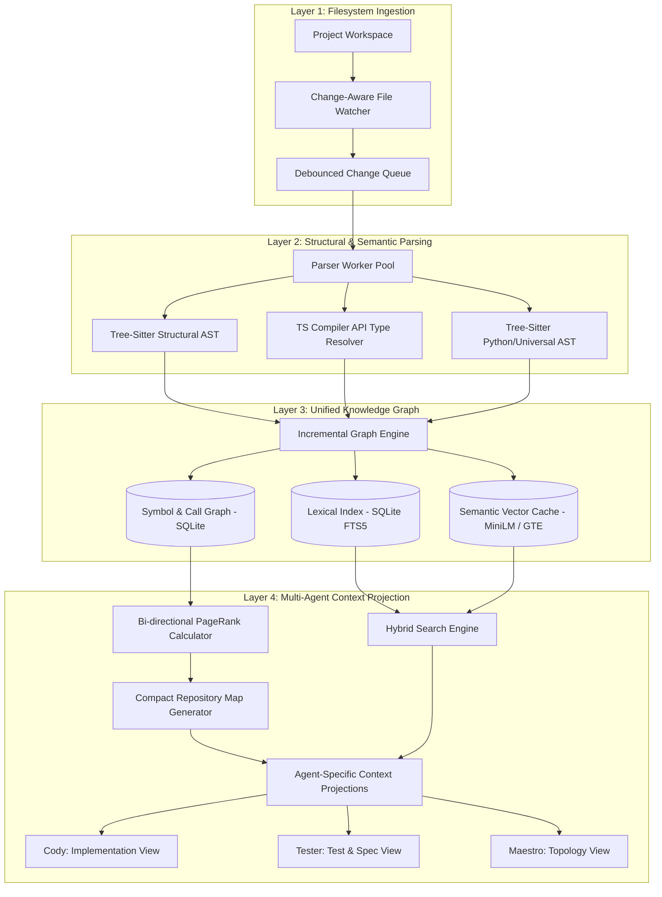
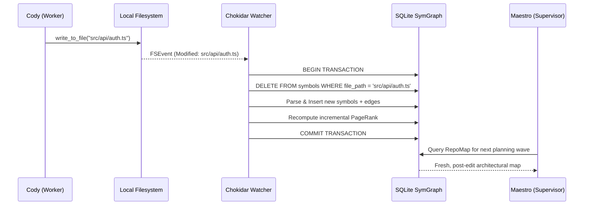
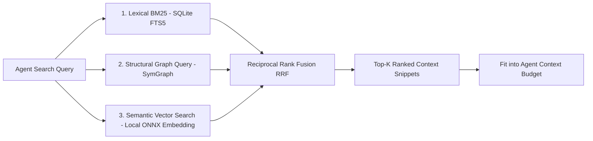

# 5. Project Intelligence Architecture: Deep Repository Understanding

> **Component:** MedioBot V2 Repository Intelligence Engine  
> **Status:** Architecture Research & Specification Document  
> **Priority:** Tier 1 — Critical Foundation  
> **Authors:** Principal AI Systems Architect, Context Engineering Specialist, AI Memory & Retrieval Researcher  

---

## 1. Executive Summary & Problem Definition

In autonomous software engineering, **context quality dictates task success**. The failure mode of naive AI coding assistants is well-understood: when given a prompt, they either inject the currently open file or blindly dump large chunks of code into the model context window until rate limits or attention degradation ("lost in the middle") cause hallucination and regression.

The existing MedioBot V2 implementation (`discoverProjectIntelligence` in `WorkspaceManager.ts`) relies on:
1. Reading `package.json` and git branch info.
2. A shallow, hard-capped traversal of 35 files (`fileInventory.slice(0, 35)`).
3. A simple text regex scan to detect frameworks (`react`, `express`, `next`).
4. Injecting this static markdown block into every prompt.

This approach fails when an agent must understand:
- Deep type hierarchies and cross-module interface contracts.
- Where a function is called, implemented, or overridden across a 500-file repository.
- Changes made five seconds ago by a peer specialist agent (e.g., Cody modifying a schema).
- Database migration schemas, route registries, and dependency injection graphs.

This document establishes the architecture for the **MedioBot V2 Unified Repository Intelligence Engine (RepoIntel)**. It synthesizes insights from **Prometheus** (*arXiv:2507.19942v2*, SWE-bench 74.4%), **abcoder-ts-parser** (*arXiv:2604.18413v2*), and **Aider’s PageRank RepoMap**, delivering a zero-redundancy, incremental, multi-agent shared graph model.

---

## 2. Theoretical Grounding & Architectural Trade-Offs

### 2.1 LSP JSON-RPC vs. Direct In-Process Compiler ASTs

A foundational question in coding agent design is whether to communicate with external Language Server Protocol (LSP) daemons (e.g., `tsserver`, `rust-analyzer`, `pyright`) or parse Abstract Syntax Trees (ASTs) in-process via Tree-sitter and Compiler APIs.

| Architectural Dimension | External LSP Server (JSON-RPC) | Direct In-Process Engine (`abcoder-ts-parser` / Tree-sitter) | Decision for MedioBot V2 |
| :--- | :--- | :--- | :--- |
| **Process Overhead** | Spawns separate heavyweight OS processes (`node tsserver.js`, ~300–800 MB RAM per project). | Runs inside Node.js worker threads using native C/WASM bindings. | **In-Process Engine** |
| **Query Latency** | High (50–300ms per request due to IPC serialization, socket roundtrips, and server event loops). | Microsecond-to-millisecond (<2ms direct memory lookups against indexed symbol tables). | **In-Process Engine** |
| **Fault Tolerance & Crashes** | LSP servers frequently crash on invalid/transient syntax states, requiring socket restart logic. | Tree-sitter is fault-tolerant and parses incomplete or syntax-errored code deterministically. | **In-Process Engine** |
| **Multi-Agent Concurrency** | Bottlenecked on a single JSON-RPC queue; concurrent queries queue behind pending compiler checks. | Shared read-only SQLite/LMDB symbol graph supports concurrent zero-lock queries from 8+ agents. | **In-Process Engine** |
| **Semantic Precision** | Full type-checking engine; exact type inference across complex generics. | Tree-sitter provides structural grammar; TypeScript Compiler API (`ts.createProgram`) provides exact types. | **Hybrid**: Tree-sitter for universal grammar + TS Compiler API for deep TS projects. |

**Verdict:** Relying purely on an external LSP daemon creates a brittle, slow, high-memory bottleneck. MedioBot V2 implements a **dual-tier in-process parser**:
1. **Tier 1 (Universal Structural AST):** `web-tree-sitter` (WASM/C bindings) for all languages (TypeScript, JavaScript, Python, Go, Rust, HTML, CSS, SQL).
2. **Tier 2 (Deep Semantic Binding):** In-process TypeScript Compiler API invocation via worker thread for exact type-signature and interface resolution.

---

## 3. Core Architecture: The 4-Layer Intelligence Pipeline



### 3.1 Layer 1: Change-Aware File Ingestion
- **Incremental Diff Watching:** Instead of rescanning the directory tree on every query, a persistent watcher (`chokidar` with native OS `FSEvents` on macOS and `ReadDirectoryChangesW` on Windows) tracks file additions, modifications, and deletions.
- **Gitignore Respect:** Native filtering honors `.gitignore`, `.ignore`, and built-in binary/build artifacts (`node_modules`, `dist`, `.git`, `.next`, `target`).
- **Debounced Batch Ingestion:** File system changes are queued with a 150ms debounce window. If a build tool or agent writes 20 files in a burst, they are parsed in a single micro-batch.

### 3.2 Layer 2: Dual Structural & Semantic Parser
- **Structural Extraction via Tree-sitter:**
  - Extracts definitions: Classes, interfaces, types, functions, methods, exported constants, routes.
  - Extracts relationships: `imports`, `exports`, `implements`, `extends`, `calls`.
  - Captures exact byte ranges, line numbers, and docstrings/JSDocs.
- **Semantic Binding via TypeScript Compiler API (`abcoder-ts-parser`):**
  - For TypeScript/JavaScript workspaces, Tree-sitter extracts structure while `ts.createSourceFile` extracts resolved type symbols without running a full, slow `ts.createProgram` emit cycle.
  - When deep interface resolution is required, the background worker invokes lightweight program AST checks to map interfaces to implementations.

### 3.3 Layer 3: Unified Project Knowledge Graph (SymGraph)
All parsed entities are stored in a local, single-file SQLite database located in `.mediobot/cache/project-intelligence.db`:

```sql
-- Core Symbol Nodes
CREATE TABLE symbols (
    id TEXT PRIMARY KEY,
    file_path TEXT NOT NULL,
    symbol_name TEXT NOT NULL,
    symbol_kind TEXT NOT NULL, -- 'function' | 'class' | 'interface' | 'type' | 'variable'
    signature TEXT NOT NULL,
    docstring TEXT,
    start_line INTEGER NOT NULL,
    end_line INTEGER NOT NULL,
    is_exported BOOLEAN NOT NULL,
    sha256 TEXT NOT NULL
);

-- Directional Relationship Edges
CREATE TABLE symbol_edges (
    source_symbol_id TEXT NOT NULL,
    target_symbol_id TEXT, -- nullable if external dependency
    edge_type TEXT NOT NULL, -- 'calls' | 'imports' | 'implements' | 'extends' | 'references'
    target_name TEXT NOT NULL,
    target_module TEXT,
    FOREIGN KEY(source_symbol_id) REFERENCES symbols(id) ON DELETE CASCADE
);

-- Full-Text Lexical Index
CREATE VIRTUAL TABLE symbols_fts USING fts5(
    file_path,
    symbol_name,
    signature,
    docstring,
    content='symbols',
    content_rowid='rowid'
);

-- Graph Metrics
CREATE TABLE symbol_metrics (
    symbol_id TEXT PRIMARY KEY,
    pagerank_score REAL NOT NULL DEFAULT 0.0,
    in_degree INTEGER NOT NULL DEFAULT 0,
    out_degree INTEGER NOT NULL DEFAULT 0,
    last_updated_at INTEGER NOT NULL
);
```

### 3.4 Layer 4: Multi-Agent Context Projection & Budget Allocation
Different agents have distinct cognitive context requirements:
- **Maestro (Orchestration):** Needs high-level architecture: major services, route handlers, database models, directory boundaries. Needs high PageRank symbols, not implementation line bodies.
- **Cody (Implementation):** Needs local call graphs, imported utility types, interface signatures, and exact caller/callee contracts for files under edit.
- **Tester (QA):** Needs test suites, mock fixtures, assertion targets, and untested edge routes.
- **Doc (Documentation):** Needs API schemas, exported interfaces, and JSDoc gaps.

---

## 4. The Budgeted Repository Map (RepoMap) Algorithm

Inspired by Aider and Prometheus (*arXiv:2507.19942v2*), the **RepoMap** compresses a 100,000-line repository into a 1,000-to-2,500 token markdown snippet that fits effortlessly into any LLM prompt.

### 4.1 Graph PageRank Formulation
1. Construct a directed graph $G = (V, E)$ where vertices $V$ are symbols and edges $E$ are cross-file imports and function calls.
2. If file $A$ imports symbol $S$ from file $B$, create an edge $A \to B$ with weight proportional to usage frequency.
3. If an agent is currently working on file $F_{active}$, apply **Personalized PageRank (Topic-Sensitive PageRank)** with teleportation probability biased toward $F_{active}$:
   $$PR(v) = (1 - d) \cdot \frac{\mathbf{1}_{F_{active}}(v)}{|F_{active}|} + d \sum_{u \in In(v)} \frac{PR(u)}{Out(u)}$$
   where $d = 0.85$.
4. Symbols with highest $PR(v)$ represent the foundational architectural backbone of the repository (e.g., core database models, base controllers, shared utility interfaces).

### 4.2 Dynamic Token Budget Packing
The RepoMap generator accepts a strict token budget (e.g., `budget = 1500 tokens`):
1. **Pass 1 (Directory & Architecture Tree):** Generate high-level directory skeleton (100 tokens).
2. **Pass 2 (Key Interfaces & Signatures):** Greedily insert top-ranked exported symbols and signatures until 80% of budget is reached.
3. **Pass 3 (Context-Sensitive Active Symbols):** Insert symbols referenced in the current turn's prompt or modified files.
4. **Pass 4 (Ellipsis & Compaction):** Strip function bodies, private symbols, and boilerplate whitespace.

#### Example Compact RepoMap Output (< 450 tokens):
```typescript
// === MedioBot V2 RepoMap (Tokens: 382 | Personalized for: apps/command-center/src/server.ts) ===
// apps/command-center/src/server.ts
export class CommandCenterServer {
  start(): Promise<void>;
  broadcastEvent(event: ExecutionEvent): void;
  private handleAgentTurn(req: TurnRequest): Promise<TurnResponse>;
}
// packages/orchestration/src/maestro.ts (Score: 0.94)
export class MaestroOrchestrator {
  dispatchTask(goal: Goal): Promise<TaskResult>;
  cancelTask(taskId: string): void;
}
// packages/runtime/src/WorkspaceManager.ts (Score: 0.88)
export class WorkspaceManager {
  resolvePath(relPath: string): string;
  discoverProjectIntelligence(forceRefresh?: boolean): Promise<ProjectIntel>;
}
// packages/contracts/src/events.ts (Score: 0.82)
export interface ExecutionEvent { type: string; agentId: string; payload: unknown; }
```

---

## 5. Incremental Change Invalidation & Multi-Agent Consistency

In a multi-agent system where Cody or another agent writes files in real time, static indexers immediately become stale and misleading.

### 5.1 Invalidation Protocol


- **Atomic SQLite Write Locks:** SQLite's WAL (Write-Ahead Logging) mode allows concurrent reads from 8+ agents without blocking during a 10ms symbol write transaction.
- **Fast Content Hashing (BLAKE3 / SHA-256):** Files are hashed before parsing. If an agent touches a file's timestamp without changing content, parsing is bypassed entirely.
- **Microsecond Invalidation:** Re-parsing a single 500-line TypeScript file via Tree-sitter takes `< 4ms`. Rebuilding the SQLite symbol entries takes `< 2ms`. The index is never stale for more than 150ms (the debounce window).

---

## 6. Hybrid Retrieval: Combining Lexical, Structural, and Semantic Search

When an agent needs to locate code beyond the pre-computed RepoMap (e.g., "Where is Stripe webhook signature verification implemented?"), naive vector search alone is insufficient because it frequently misses exact identifier matches (`STRIPE_WEBHOOK_SECRET`).

MedioBot V2 implements **Reciprocal Rank Fusion (RRF)** across three retrieval channels:



### 6.1 Reciprocal Rank Fusion Formula
For each candidate code snippet $d \in D$:
$$RRF\_Score(d) = \sum_{m \in \{lex, struct, sem\}} \frac{w_m}{k + rank_m(d)}$$
where $k = 60$, $w_{lex} = 1.0$, $w_{struct} = 1.2$, and $w_{sem} = 0.8$.

- **Structural queries** receive the highest weight: if a query matches an exact symbol name or interface signature in `SymGraph`, it immediately surfaces to the top.
- **Lexical BM25 (`symbols_fts`)** handles exact variable names, error codes, and configuration strings.
- **Semantic embeddings** (using a lightweight in-process ONNX model like `all-MiniLM-L6-v2` or `gte-small`) handle conceptual natural-language descriptions.

---

## 7. Evidence Grounding: Fact vs. Summary vs. Inference

A core requirement of the MedioBot V2 architecture is distinguishing verifiable facts from synthetic model guesses.

In `RepoIntel`, every piece of context emitted carries an immutable **Provenance Tag**:

```typescript
export interface ProvenanceMetadata {
  provenanceType: 'VERIFIED_SOURCE_FACT' | 'GENERATED_SUMMARY' | 'INFERRED_RELATIONSHIP' | 'HISTORICAL_OBSERVATION';
  sourceFile: string;
  sourceLineRange?: [number, number];
  contentSha256: string;
  timestamp: number;
  confidence: number; // 1.0 for verified AST facts, 0.5-0.8 for inferred relationships
}
```

- `VERIFIED_SOURCE_FACT`: Extracted directly from AST or source bytes. Can be verified by re-reading the file.
- `GENERATED_SUMMARY`: LLM-generated distillation of a module or directory. Must be flagged so agents do not treat it as literal source syntax.
- `INFERRED_RELATIONSHIP`: E.g., an implicit dependency inferred from dynamic string imports or naming conventions.
- `HISTORICAL_OBSERVATION`: A past observation from a previous conversation turn or Git commit.

When an agent renders a plan or claim, the reliability engine cross-references the claim's citations against `VERIFIED_SOURCE_FACT` records. Unsubstantiated claims are rejected prior to execution.

---

## 8. Cross-Agent Shared Index vs. Redundant Work

In existing multi-agent prototypes, each agent often runs its own repository scan, ballooning CPU and memory usage by $N \times$.

Under MedioBot V2:
1. **Single Central Index Process:** `WorkspaceManager` owns the one and only `RepoIntel` SQLite instance and file watcher per workspace.
2. **Zero-Copy In-Process Queries:** Specialist agents (Cody, Tester, Doc, etc.) run in the same Node.js runtime (or communicate via fast local IPC) and query the shared SQLite database concurrently in WAL mode.
3. **Agent-Scoped Projections:** Agents pass their persona and target files to `RepoIntel.getContextProjection(agentId, persona, activeFiles, tokenBudget)`.
4. **Memory Footprint:** 
   - SQLite DB on disk: ~2 MB to 15 MB for a 10,000-file repository.
   - Active RAM: ~25 MB to 60 MB for WASM Tree-sitter parsers and SQLite cache.
   - Compare to 4 concurrent LSP servers: > 2.5 GB RAM.

---

## 9. Conclusion & Transition to Memory Architecture

The Unified Repository Intelligence Engine transforms MedioBot from an assistant that "only knows the open file" into an agent team that possesses an exact, queryable, living architectural map of the entire codebase.

This structural foundation directly feeds into **Deliverable 6: Memory and Retrieval Research**, which establishes how past developer decisions, conventions, and problem-solving experiences are preserved across sessions.
