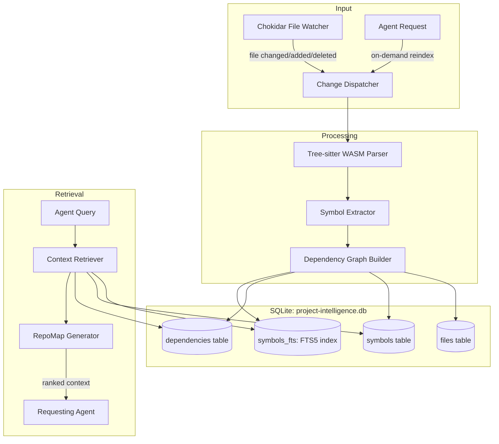

# PROJECT INTELLIGENCE ENGINE — Specification

> **Author:** Principal AI Systems Architect (Opus Audit)
> **Date:** 2026-10-13
> **Status:** PROPOSED — Highest Priority Implementation Target
> **Replaces:** Current `discoverProjectIntelligence()` in `packages/maestro/src/discovery.ts`

---

## 1. Problem Statement

The current project intelligence system scans only 35 top-level filesystem entries and reads up to 4-8 KB from root manifests. This creates a **"blind assistant" bottleneck** where MedioBot has no knowledge of:
- Internal module structure
- Function signatures and types
- Import/dependency relationships
- API endpoints and database schemas
- Test coverage or errors
- Coding conventions

Every discovery beyond root files requires expensive serial LLM tool calls via Cody.

---

## 2. Design Goals

1. **Accurate**: Index real AST structures, not heuristic guesses
2. **Incremental**: Update only changed files, not full re-index
3. **Fast**: Sub-50ms context retrieval for any agent query
4. **Economical**: Produce compact representations (< 2,000 tokens for RepoMap)
5. **Shared**: All agents access the same intelligence, no duplication
6. **Source-Linked**: Every retrieved fact links back to file:line
7. **Cross-Platform**: Works on macOS (ARM64/x64) and Windows
8. **Fallback-Safe**: Degrades to legacy scan if indexing fails

---

## 3. Architecture



---

## 4. SQLite Schema

```sql
-- Project Intelligence Database
-- Location: .mediobot/cache/project-intelligence.db

PRAGMA journal_mode = WAL;
PRAGMA synchronous = NORMAL;

-- Indexed files with content hashing for incremental updates
CREATE TABLE IF NOT EXISTS files (
    file_id     INTEGER PRIMARY KEY AUTOINCREMENT,
    path        TEXT NOT NULL UNIQUE,           -- Relative to workspace root
    language    TEXT,                            -- Detected language (typescript, python, etc.)
    content_hash TEXT NOT NULL,                  -- SHA-256 of file contents
    size_bytes  INTEGER NOT NULL,
    line_count  INTEGER NOT NULL,
    indexed_at  INTEGER NOT NULL DEFAULT (unixepoch()),
    is_test     INTEGER NOT NULL DEFAULT 0,     -- Whether file is a test file
    is_config   INTEGER NOT NULL DEFAULT 0      -- Whether file is a config file
);

-- Extracted symbols (functions, classes, interfaces, exports)
CREATE TABLE IF NOT EXISTS symbols (
    symbol_id   INTEGER PRIMARY KEY AUTOINCREMENT,
    file_id     INTEGER NOT NULL REFERENCES files(file_id) ON DELETE CASCADE,
    name        TEXT NOT NULL,
    kind        TEXT NOT NULL,                  -- 'function' | 'class' | 'interface' | 'type' | 'variable' | 'export' | 'method'
    signature   TEXT,                           -- Compact type signature if available
    start_line  INTEGER NOT NULL,
    end_line    INTEGER NOT NULL,
    is_exported INTEGER NOT NULL DEFAULT 0,
    parent_symbol_id INTEGER REFERENCES symbols(symbol_id) ON DELETE CASCADE,
    doc_comment TEXT                            -- JSDoc/docstring if present
);

CREATE INDEX IF NOT EXISTS idx_symbols_name ON symbols(name);
CREATE INDEX IF NOT EXISTS idx_symbols_file ON symbols(file_id);
CREATE INDEX IF NOT EXISTS idx_symbols_kind ON symbols(kind);

-- Full-text search over symbol names and signatures
CREATE VIRTUAL TABLE IF NOT EXISTS symbols_fts USING fts5(
    name, signature, doc_comment,
    content=symbols,
    content_rowid=symbol_id,
    tokenize='porter unicode61'
);

-- Import/dependency relationships between files
CREATE TABLE IF NOT EXISTS dependencies (
    dep_id      INTEGER PRIMARY KEY AUTOINCREMENT,
    source_file INTEGER NOT NULL REFERENCES files(file_id) ON DELETE CASCADE,
    target_file INTEGER REFERENCES files(file_id) ON DELETE SET NULL,
    import_path TEXT NOT NULL,                  -- Raw import specifier
    imported_names TEXT NOT NULL DEFAULT '[]',  -- JSON array of imported names
    is_type_only INTEGER NOT NULL DEFAULT 0
);

CREATE INDEX IF NOT EXISTS idx_deps_source ON dependencies(source_file);
CREATE INDEX IF NOT EXISTS idx_deps_target ON dependencies(target_file);

-- Project-level metadata
CREATE TABLE IF NOT EXISTS project_metadata (
    key         TEXT PRIMARY KEY,
    value       TEXT NOT NULL,
    updated_at  INTEGER NOT NULL DEFAULT (unixepoch())
);
-- Keys: 'frameworks', 'languages', 'package_manager', 'build_tool', 'test_framework'

-- Triggers for FTS synchronization
CREATE TRIGGER IF NOT EXISTS symbols_fts_insert AFTER INSERT ON symbols BEGIN
    INSERT INTO symbols_fts(rowid, name, signature, doc_comment)
    VALUES (new.symbol_id, new.name, new.signature, new.doc_comment);
END;

CREATE TRIGGER IF NOT EXISTS symbols_fts_delete AFTER DELETE ON symbols BEGIN
    INSERT INTO symbols_fts(symbols_fts, rowid, name, signature, doc_comment)
    VALUES ('delete', old.symbol_id, old.name, old.signature, old.doc_comment);
END;
```

---

## 5. TypeScript Interfaces

```typescript
// packages/intelligence/src/types.ts — PROPOSED

export interface ProjectIntelligenceEngine {
  /** Initialize or open the intelligence database for a workspace */
  initialize(workspaceRoot: string): Promise<void>;

  /** Perform full index of the workspace (first run or forced rebuild) */
  fullIndex(signal: AbortSignal): Promise<IndexReport>;

  /** Incrementally update index for changed files */
  incrementalUpdate(changedPaths: ReadonlyArray<string>): Promise<IndexReport>;

  /** Generate a compact RepoMap within a token budget */
  generateRepoMap(options: RepoMapOptions): Promise<RepoMap>;

  /** Search for symbols by name or query */
  searchSymbols(query: string, options?: SearchOptions): Promise<ReadonlyArray<SymbolResult>>;

  /** Get all symbols in a file */
  getFileSymbols(filePath: string): Promise<ReadonlyArray<SymbolResult>>;

  /** Get dependency graph for a file (what it imports, what imports it) */
  getFileDependencies(filePath: string): Promise<FileDependencyGraph>;

  /** Get project-level metadata */
  getProjectMetadata(): Promise<ProjectMetadata>;

  /** Shut down and release resources */
  dispose(): Promise<void>;
}

export interface IndexReport {
  readonly filesIndexed: number;
  readonly filesSkipped: number;
  readonly symbolsExtracted: number;
  readonly dependenciesTracked: number;
  readonly durationMs: number;
  readonly errors: ReadonlyArray<{ path: string; error: string }>;
}

export interface RepoMapOptions {
  readonly maxTokens: number;          // Default: 1500
  readonly focusPaths?: ReadonlyArray<string>;  // Boost relevance of specific files
  readonly focusSymbols?: ReadonlyArray<string>; // Boost relevance of specific symbols
  readonly includeSignatures: boolean; // Include function signatures in map
}

export interface RepoMap {
  readonly content: string;            // The formatted repo map text
  readonly estimatedTokens: number;
  readonly filesIncluded: number;
  readonly generationMs: number;
}

export interface SymbolResult {
  readonly name: string;
  readonly kind: string;
  readonly filePath: string;
  readonly startLine: number;
  readonly endLine: number;
  readonly signature: string | null;
  readonly isExported: boolean;
  readonly docComment: string | null;
}

export interface FileDependencyGraph {
  readonly imports: ReadonlyArray<{ path: string; names: ReadonlyArray<string> }>;
  readonly importedBy: ReadonlyArray<{ path: string; names: ReadonlyArray<string> }>;
}

export interface ProjectMetadata {
  readonly languages: ReadonlyArray<string>;
  readonly frameworks: ReadonlyArray<string>;
  readonly packageManager: string | null;
  readonly testFramework: string | null;
  readonly totalFiles: number;
  readonly totalSymbols: number;
}

export interface SearchOptions {
  readonly maxResults?: number;        // Default: 20
  readonly kinds?: ReadonlyArray<string>; // Filter by symbol kind
  readonly exportedOnly?: boolean;
}
```

---

## 6. Tree-sitter Integration

### 6.1 Language Support (Priority Order)
1. **TypeScript/TSX** — Primary language of MedioBot itself
2. **JavaScript/JSX** — Widely used in target projects
3. **Python** — Common ML/backend language
4. **Rust** — Systems programming
5. **Go** — Backend services
6. **HTML/CSS** — Web frontend
7. Additional languages added via WASM grammar packages

### 6.2 Symbol Extraction Strategy

For each parsed file, Tree-sitter produces an AST. The Symbol Extractor walks the AST and extracts:

| AST Node Type | Extracted Symbol Kind |
|---------------|----------------------|
| `function_declaration` | `function` |
| `class_declaration` | `class` |
| `interface_declaration` | `interface` |
| `type_alias_declaration` | `type` |
| `method_definition` | `method` |
| `export_statement` | marks child as `is_exported` |
| `import_statement` | creates `dependency` record |
| `variable_declarator` (top-level) | `variable` |

### 6.3 Incremental Update Logic

```
On file change event:
  1. Compute SHA-256 of new file contents
  2. Compare with stored content_hash in files table
  3. If hash matches → skip (no change)
  4. If hash differs:
     a. DELETE FROM symbols WHERE file_id = ?
     b. DELETE FROM dependencies WHERE source_file = ?
     c. Re-parse file with Tree-sitter
     d. Re-extract symbols and dependencies
     e. UPDATE files SET content_hash = ?, indexed_at = ?
  5. If file deleted:
     a. DELETE FROM files WHERE path = ? (CASCADE deletes symbols/deps)
```

---

## 7. RepoMap Generation (PageRank-Inspired)

### 7.1 Algorithm

1. Build a directed graph where nodes are files and edges are import relationships
2. Compute PageRank scores (files that are imported by many other files rank higher)
3. Sort files by PageRank score descending
4. For each file (in rank order), emit:
   - File path
   - Exported symbols with compact signatures
5. Stop when token budget is reached

### 7.2 Token Budgeting

The RepoMap budget should be **adaptive**:
- **Small projects** (< 50 files): `min(fileCount × 5, 500)` tokens
- **Medium projects** (50-500 files): `min(fileCount × 3, 1500)` tokens
- **Large projects** (500+ files): Fixed 2000 tokens (only top-ranked files)

When a task specifies focus files/symbols, those files receive a PageRank boost (multiplied by 3x).

---

## 8. LSP Integration Decision

**DECISION: Defer LSP integration to Phase 7+.**

**Rationale:**
- LSP provides rich type information, diagnostics, and completions
- However, LSP requires running a language server per workspace, which adds:
  - Process management complexity
  - Memory overhead (TypeScript tsserver: ~100-300 MB)
  - Startup latency (5-30 seconds for large projects)
- Tree-sitter + FTS5 covers 80-90% of the intelligence needs for initial phases
- LSP integration can be added later for:
  - Real-time type error detection
  - Rename refactoring support
  - Go-to-definition accuracy improvements

---

## 9. Performance Requirements

| Metric | Target | Measurement Method |
|--------|--------|-------------------|
| Full index (500-file project) | < 5 seconds | Wall clock from init to completion |
| Incremental update (single file) | < 100ms | Time from watcher event to DB committed |
| Symbol search (FTS5) | < 10ms | Query to results array |
| RepoMap generation | < 50ms | Query to formatted string |
| Idle CPU usage (watcher) | < 0.5% | 60-second average during no-edit periods |
| Database size (500-file project) | < 5 MB | On-disk size of project-intelligence.db |

---

## 10. Failure Modes and Fallbacks

| Failure | Detection | Fallback |
|---------|-----------|----------|
| Tree-sitter WASM load failure | Catch during initialization | Fall back to regex-based symbol extraction |
| SQLite database corruption | PRAGMA integrity_check | Delete and rebuild database |
| File watcher failure | Chokidar error event | Manual reindex on agent request |
| Parser crash on malformed file | Try-catch per file | Skip file, log error, continue indexing |
| Token budget exceeded | Counter during RepoMap generation | Truncate to budget |

---

## 11. Migration from Legacy Discovery

The existing `discoverProjectIntelligence()` function in `discovery.ts` must be preserved as a fallback. The migration strategy:

1. **Phase 1A:** Implement PIE alongside legacy discovery
2. **Phase 1B:** Add feature flag `USE_PROJECT_INTELLIGENCE=true`
3. **Phase 1C:** Route `compileMaestroContext` to use PIE when flag is enabled
4. **Phase 1D:** Benchmark PIE vs. legacy on 5 real-world projects
5. **Phase 1E:** Remove legacy discovery when PIE is proven stable (Phase 3+)

The legacy function (`discoverProjectIntelligence`) is ~195 lines and well-contained. It can remain indefinitely as a safety fallback without maintenance burden.
