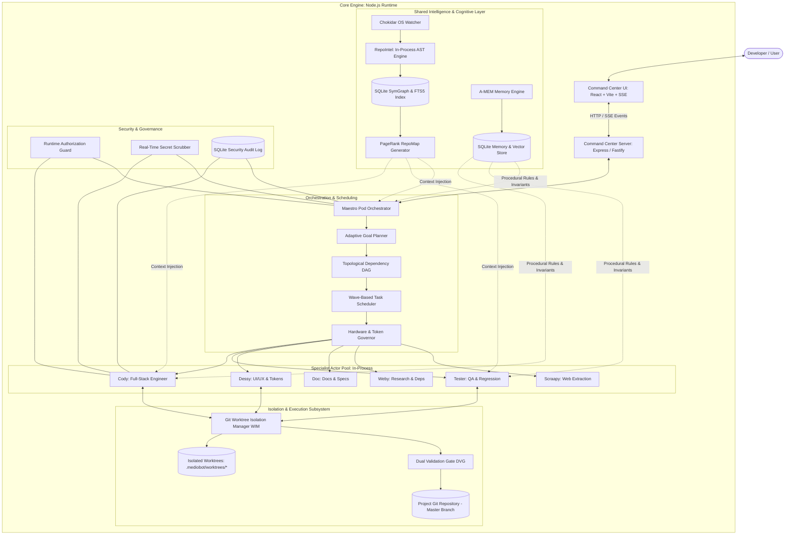

# 14. Recommended Architecture: The Autonomous Agile Pod Specification

> **Component:** MedioBot V2 System Architecture Specification  
> **Status:** Recommended Design & Technical Blueprint  
> **Priority:** Tier 1 — The Master Blueprint  
> **Authors:** Entire Architecture & Research Directorate  

---

## 1. Executive Summary & Architectural Overview

MedioBot V2 evolves from a sequential coding assistant into an **Autonomous Agile Software Engineering Pod**.

The system mirrors a high-performing software engineering team:
- **Maestro** acts as the Principal Engineering Lead and Product Owner, holding overall responsibility for the user's high-level goal, decomposing requirements into a dependency graph, scheduling specialists into execution waves, and managing human approvals.
- **Specialist Mediobots** (Cody, Tester, Dessy, Doc, Weby, Scraapy, Vision) act as focused domain engineers with bounded toolsets, isolated worktrees, and just-in-time skills.
- The **Repository Intelligence Engine (RepoIntel)** acts as the living architectural source of truth, providing AST-verified symbol graphs and compact RepoMaps.
- The **Worktree Isolation Manager (WIM)** enables 4 to 8 agents to write, build, and test simultaneously without file collisions or workspace contamination.
- The **Dual Validation Gate (DVG)** enforces strict structural and execution-based verification before any code merges into the master branch.

---

## 2. Complete End-to-End System Architecture

---

## 3. Retain, Extend, Replace, or Remove Analysis

To maintain architectural integrity and honor existing working software, we explicitly categorize every component in the current MedioBot V2 repository:

| Existing Component | File Path | Strategic Decision | Rationale & Action Plan |
| :--- | :--- | :--- | :--- |
| **Command Center Server** | `apps/command-center/src/server.ts` | **RETAIN & EXTEND** | Excellent foundation; holds SQLite session persistence and SSE event broadcast. Extend with wave-state routes and worktree telemetry. |
| **Command Center UI** | `apps/command-center/src/App.tsx` | **RETAIN & EXTEND** | Verified working frontend with timeline navigator, diff viewers, and agent drawer. Extend with multi-agent parallel wave visualizations. |
| **WorkspaceManager** | `packages/runtime/src/WorkspaceManager.ts` | **REPLACE (Core Engine)** | Replace naive 35-file regex scan with `RepoIntel` Tree-sitter + SQLite SymGraph engine. Retain safe path resolution guards. |
| **Maestro Orchestrator** | `packages/orchestration/src/maestro.ts` | **EXTEND & UPGRADE** | Upgrade from sequential fallback loops to **Topological Wave Execution (SPOQ)** DAG dispatch. |
| **Cody Agent Definition** | `packages/runtime/src/agents/cody.ts` | **RETAIN & REFINE** | Retain core implementation persona; scope tool execution strictly to assigned Git worktree paths. |
| **Agent Registry** | `packages/runtime/src/agents/` | **EXTEND** | Add formal runtime definitions and bounded tool schemas for Tester, Doc, Dessy, Weby, and Scraapy. |
| **Tool Registry** | `packages/runtime/src/tools/` | **EXTEND** | Add `query_repomap`, `run_worktree_command`, `inspect_symbol`, and `submit_task_evidence`. |
| **Session Persistence** | `packages/runtime/src/db/` | **RETAIN & EXTEND** | Retain SQLite database; add tables for SymGraph, A-MEM Zettelkasten notes, and wave audit logs. |
| **Live Vision Stub** | N/A | **DEFER / ISOLATE** | Keep vision capability stubbed cleanly until local computer-vision inference stack is validated in future milestones. |

---

## 4. Component Interaction & Execution Lifecycle

### 4.1 The Step-by-Step Goal Lifecycle
1. **User Goal Submission:** User enters prompt in Command Center UI.
2. **Context Synthesis:** Maestro queries `RepoIntel` for high-level repository topology and `A-MEM` for relevant project conventions and failure invariants.
3. **Plan Formulation (The DAG):** Maestro decomposes the goal into a directed acyclic graph of tasks, grouping non-dependent tasks into **Execution Waves** ($W_0, W_1, \dots$).
4. **Adaptive Resource Gating:** Hardware Governor checks current available RAM and CPU load. Concurrency is scaled to the machine tier (2, 4, or 8 workers).
5. **Parallel Worktree Dispatch:**
   - WIM provisions an isolated Git worktree for each task in wave $W_i$.
   - Specialist agents are instantiated as lightweight in-process actors.
   - Dynamic skills and targeted RepoMap context are injected JIT.
6. **Concurrent Execution:** Specialists execute tools inside their isolated worktrees. Edits are tracked locally via Git commits.
7. **Dual Validation & Merging:**
   - On task completion, worktrees submit changes to the Dual Validation Gate.
   - Gate 1 validates syntax, types, and citations.
   - Gate 2 validates unit tests.
   - Verified changes are merged atomically into the master branch.
8. **Wave Progression & Replanning:** Maestro inspects completed evidence artifacts. If an agent failed, the circuit breaker triggers replanning. If successful, Wave $W_{i+1}$ begins.
9. **Goal Completion & Audit Log:** Final solution is presented to the user with a consolidated diff and test evidence report.

---

## 5. Walkthrough of Realistic Execution Scenarios

### Scenario A: Simple Question
- **User Prompt:** *"What port does our command-center backend run on?"*
- **Execution Flow:**
  1. Maestro receives prompt.
  2. Evaluates task complexity: **Zero Specialists Required**.
  3. Maestro queries `RepoIntel.searchSymbols("PORT")` or inspects `apps/command-center/src/server.ts`.
  4. Locates `const PORT = process.env.PORT || 4173;` with 100% verified citation.
  5. Maestro answers immediately in $< 1.2\text{ seconds}$ without spawning Cody or creating worktrees.

### Scenario B: Repository Understanding
- **User Prompt:** *"Explain my entire project architecture."*
- **Execution Flow:**
  1. Maestro requests high-level architecture view from `RepoIntel`.
  2. `RepoIntel` generates a global PageRank RepoMap identifying top 15 core architectural modules (server, orchestrator, workspace manager, database schema, event bus).
  3. Maestro constructs an evidence-grounded structural explanation with file links, Mermaid dependency diagrams, and framework summaries.
  4. Zero file modifications, zero worktrees, zero hallucination.

### Scenario C: Build an Advanced E-Commerce Application
- **User Prompt:** *"Build a full-featured e-commerce checkout flow with cart state, Stripe webhook handler, and modern product cards."*
- **Execution Flow:**
  1. **Maestro Planning:** Creates 3-Wave DAG:
     - *Wave 0 (Research & Scaffolding):* Weby retrieves Stripe API v2026 specs; Doc inspects database models; Dessy extracts color palette tokens.
     - *Wave 1 (Parallel Implementation - 3 Worktrees):*
       - `WT-1 (Cody-Backend):` Implements `/api/checkout` and webhook handler in `apps/server/src/routes/stripe.ts`.
       - `WT-2 (Cody-Frontend):` Implements `CartContext.tsx` and state management.
       - `WT-3 (Dessy):` Implements `ProductCard.tsx` with responsive layout and micro-animations.
     - *Wave 2 (Integration & QA):*
       - `WT-4 (Tester):` Authors and executes Stripe webhook integration tests and cart mutation assertions.
  2. **Concurrency Execution:** All 3 tasks in Wave 1 run simultaneously in physically separate worktrees. No file collisions occur.
  3. **Verification:** Wave 1 branches pass DVG and merge to `main`. Wave 2 validates the integrated application end-to-end.
  4. Maestro reports goal complete with interactive preview links.

### Scenario D: Existing Project Modification
- **User Prompt:** *"Refactor our authentication middleware to use JWT refresh tokens without breaking existing login routes."*
- **Execution Flow:**
  1. Maestro assigns Cody to inspect existing `auth.ts` callers via `RepoIntel` symbol graph.
  2. Identifies 14 route handlers calling `verifyToken()`.
  3. Tester writes a failing regression test capturing current route expectations.
  4. Cody implements the non-breaking refresh token rotation in an isolated worktree.
  5. DVG runs the full existing test suite: 14/14 existing routes continue to pass; new refresh test passes.
  6. Atomic merge to main.

### Scenario E: Failure Recovery
- **User Prompt:** *"Upgrade our SQLite database driver to modern sqlite-vec."*
- **Execution Flow:**
  1. Cody attempts naive compile; build fails with C++ native binding errors on Windows.
  2. Cody attempts identical command; Circuit Breaker trips on Attempt 2 (Loop Stagnation detected).
  3. Worktree is cleanly rolled back via `git reset --hard`.
  4. Failure is classified as `ENVIRONMENT_COMPILATION_ERROR` and logged to Failure Index.
  5. Maestro replans: Dispatches Weby to search official pre-built binary installation instructions for the platform.
  6. Weby returns verified pre-compiled package flag (`npm install --build-from-source=false`).
  7. Cody re-attempts with verified flag; build passes; worktree merged successfully.

---

## 6. Summary & Transition to Roadmap

The Recommended Architecture transforms MedioBot into a resilient, parallel, self-verifying engineering pod.

In **Deliverable 15: Implementation Roadmap**, we outline the phased, design-only rollout plan to incrementally construct this architecture across six discrete milestones.
