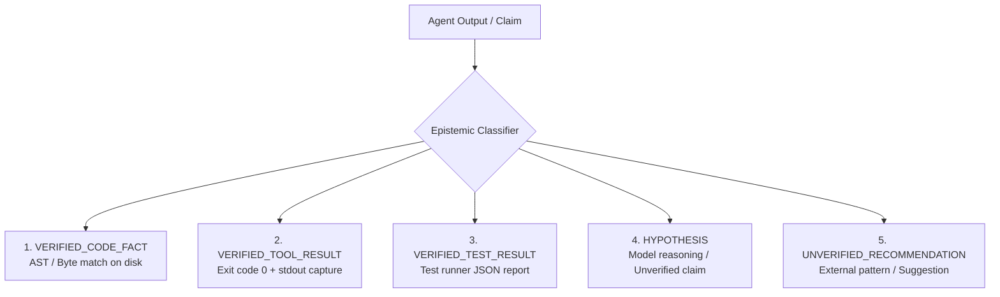
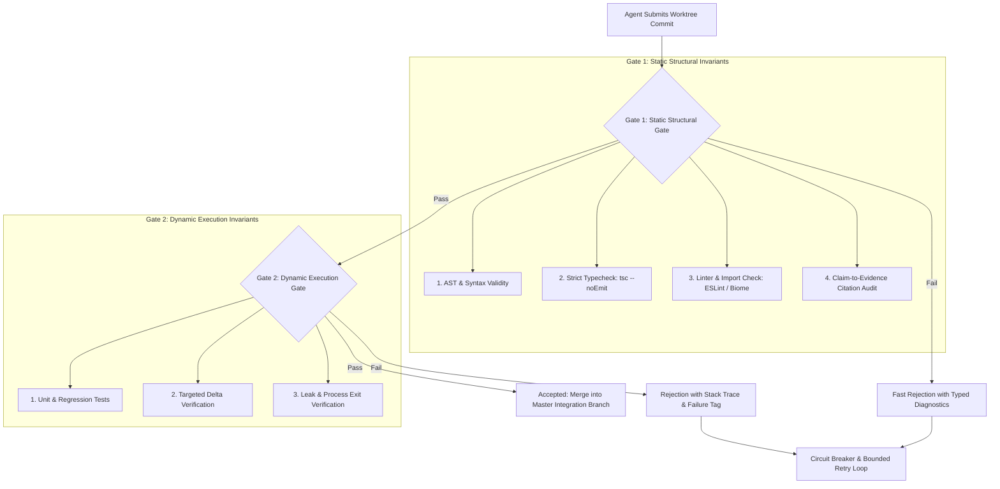
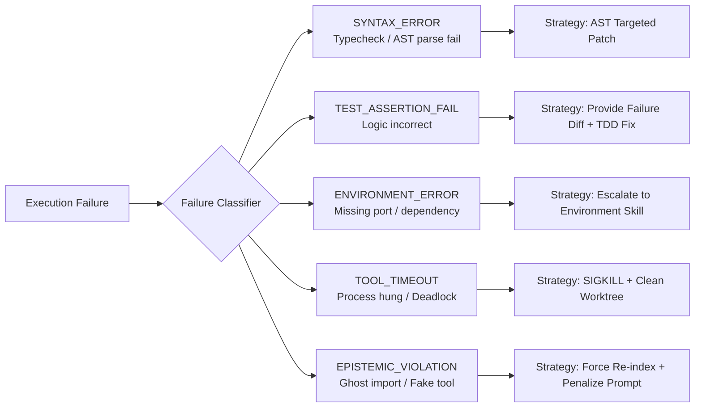
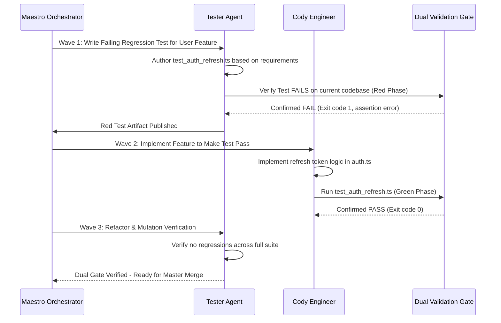

# 9. Reliability and Verification: Grounding Invariants, Dual Validation Gates, and Failure Taxonomies

> **Component:** MedioBot V2 Reliability & Grounding Subsystem  
> **Status:** Architecture Research & Specification Document  
> **Priority:** Tier 1 — Trust & Correctness  
> **Authors:** AI Reliability and Evaluation Engineer, Autonomous Software Engineering Researcher, Principal AI Systems Architect  

---

## 1. Executive Summary & Problem Definition

In autonomous software engineering, **an agent that produces subtle, unverifiable bugs is worse than no agent at all**.

Unconstrained language models exhibit systemic unreliability patterns:
1. **Unfounded Confabulation:** Claiming a test passed when it was never executed.
2. **Ghost Imports:** Importing modules or symbols that do not exist in the codebase.
3. **Circular Retries:** Repeating the exact same failing shell command or code edit across 5 consecutive turns until token budgets are exhausted.
4. **Silent Regressions:** Fixing one function while breaking three unrelated callers elsewhere in the repository.

This document establishes the **MedioBot V2 Verification Architecture**. Grounded in empirical evaluation principles from SWE-bench Verified and modern program analysis, it introduces:
- The **Epistemic Classification Hierarchy** (distinguishing verified facts from model hypotheses).
- The **Dual Validation Gate** (structural + execution verification).
- The **Standardized Failure Taxonomy & Bounded Circuit Breaker**.
- Measurable reliability metrics for benchmark tracking.

---

## 2. The Epistemic Classification Hierarchy

MedioBot V2 enforces a strict cognitive typing system for every statement, output, and plan generated by agents. No agent may present an unverified claim as an established fact.



| Epistemic Class | Definition | Verification Mechanism | Permitted Action |
| :--- | :--- | :--- | :--- |
| **`VERIFIED_CODE_FACT`** | An assertion about an existing symbol, line, or file in the repo. | Cryptographic hash match against `RepoIntel` SQLite AST. | Can be relied upon for code generation without further checks. |
| **`VERIFIED_TOOL_RESULT`** | Output produced by a successfully completed local tool execution. | Tool execution ID + deterministic process exit code recorded in SQLite. | Can be used as evidence in task ledgers. |
| **`VERIFIED_TEST_RESULT`** | Assertion that a test suite passed or failed. | Structured JUnit / Vitest JSON report parsed directly from test runner. | Prerequisite for merging any code worktree. |
| **`HYPOTHESIS`** | A model's theoretical explanation of why a bug occurred. | Must be labeled as `[Hypothesis]`; cannot be stated as a verified fact. | May guide exploratory tool execution. |
| **`UNVERIFIED_RECOMMENDATION`**| An external library pattern or proposed change not yet tested locally. | Must be validated through local compilation before acceptance. | Cannot be merged to `main`. |

---

## 3. The Dual Validation Gate (DVG) Architecture

No code generated by an agent is permitted to touch the user's primary working branch without passing through the **Dual Validation Gate (DVG)**.



### 3.1 Gate 1: Static Structural Invariants
Executed in $< 1.5\text{ seconds}$ inside the agent's isolated worktree:
1. **Syntax Integrity:** File parsed via Tree-sitter. If any `ERROR` nodes are detected, execution halts immediately.
2. **Zero Missing Imports (Ghost Import Guard):** Every imported symbol is cross-referenced against the `RepoIntel` symbol graph. If an agent imports `import { authenticate } from './auth'` and `authenticate` is not an exported symbol in `auth.ts`, the commit is rejected at the gate.
3. **Strict Typecheck:** Runs `tsc --noEmit` targeting modified files. Zero new compiler diagnostics permitted.
4. **Citation Audit:** If the agent claimed in its reasoning that a file contained a specific function, the gate verifies that the claim matches current disk bytes.

### 3.2 Gate 2: Dynamic Execution Invariants
1. **Targeted Regression Suite:** Executes tests associated with the modified files plus all upstream dependents identified in the call graph.
2. **Deterministic Exit Codes:** Scripts must terminate with clean exit code `0`. Dangling background processes or hung timers fail the gate.

---

## 4. Standardized Failure Taxonomy & The Bounded Circuit Breaker

When an agent encounters a failure, blind retry loops ("let me try again") waste tokens and propagate confusion. MedioBot V2 classifies all failures into a formal taxonomy and applies deterministic recovery strategies.



### 4.1 Bounded Circuit Breaker Protocol
- **Max Retries per Subtask:** Hard-capped at **3 attempts**.
- **Identical Action Detection:** If an agent attempts the exact same tool call with identical arguments that previously failed, the Circuit Breaker trips immediately on Attempt 2.
- **Circuit Breaker Tripped Action:**
  1. The subtask is marked `FAILED_CIRCUIT_BROKEN`.
  2. The agent's worktree is reset to the wave start checkpoint: `git reset --hard HEAD~1`.
  3. Maestro is notified with a structured failure diagnostic:
     ```json
     {
       "failureType": "SYNTAX_ERROR",
       "rootCause": "Cannot find module '@/components/button'",
       "attempts": 3,
       "recommendedAction": "REASSIGN_TO_DOC_OR_REPLAN"
     }
     ```
  4. Maestro replans the DAG (e.g., dispatching Doc to investigate missing dependencies before re-attempting implementation).

---

## 5. Test-Driven Agent Workflows (TDD by Construction)

To eliminate the illusion of progress, MedioBot V2 prioritizes **Test-Driven Agent Workflows**:



- **Red-Green Invariant:** A feature is never declared "complete" based on Cody's textual assertion. It is complete only when an independent test written by Tester transitions from **Red (failing)** to **Green (passing)**.

---

## 6. Measurable Reliability & Grounding Metrics

To rigorously track improvements across releases, MedioBot V2 defines six quantitative reliability metrics:

| Metric Name | Mathematical Definition | Target for V2 Production |
| :--- | :--- | :--- |
| **Claim Grounding Accuracy (CGA)** | $\frac{\text{Verified Citations in Plan}}{\text{Total Assertions in Plan}}$ | $\ge 98.5\%$ |
| **First-Pass Validation Rate (FPVR)** | $\frac{\text{Worktrees Passing DVG on Attempt 1}}{\text{Total Worktree Submissions}}$ | $\ge 82.0\%$ |
| **Ghost Import Frequency (GIF)** | $\frac{\text{Unresolved Symbol References}}{\text{Total Source Imports Written}}$ | $0.00\%$ (Zero Tolerance) |
| **Loop Stagnation Rate (LSR)** | $\frac{\text{Runs Tripping Circuit Breaker}}{\text{Total Executed Tasks}}$ | $\le 4.0\%$ |
| **SWE-bench Verification Rate** | Pass percentage on standard SWE-bench Verified test cases | $\ge 68.0\%$ |
| **Rollback Rate (RR)** | $\frac{\text{Integrated Commits Reverted Post-Merge}}{\text{Total Integrated Commits}}$ | $\le 1.0\%$ |

---

## 7. Summary & Transition to Self-Improvement

The Verification Engine provides:
- **Zero ungrounded claims:** Strict epistemic typing ensures agents never mistake guesses for facts.
- **Dual validation gates:** Syntax, types, citations, and unit tests must pass before code is merged.
- **Circuit breaker safety:** Terminates unproductive loops within 3 bounded retries.
- **TDD by construction:** Red-to-Green test verification replaces conversational self-assessment.

In **Deliverable 10: Self-Improvement Research**, we evaluate how the agent team learns safely from past failures without unrestricted, unvetted self-modification.
