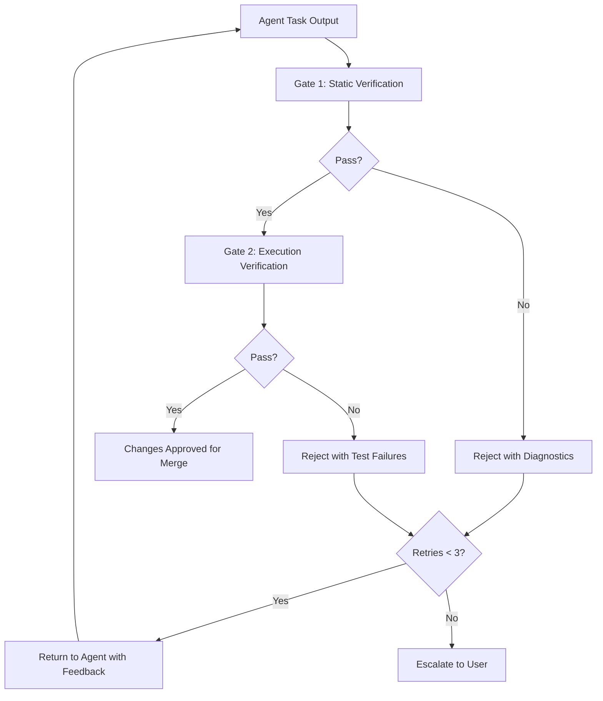

# RELIABILITY AND VERIFICATION SPEC — MedioBot V2

> **Author:** Principal AI Systems Architect (Opus Audit)
> **Date:** 2026-10-13
> **Status:** PROPOSED — Evidence-First Execution Architecture
> **Affects:** All agent execution paths

---

## 1. Core Principle

**Every claim an agent makes must be traceable to evidence.** MedioBot distinguishes between:

| Evidence Level | Definition | Examples |
|---------------|------------|----------|
| **Verified Fact** | Confirmed by deterministic tool output | File exists, test passes, command exits 0 |
| **Tool Result** | Raw output from tool execution | File contents, terminal output, search results |
| **Source Evidence** | Directly read from source code | Function signature at file:line |
| **Test Result** | Outcome of automated test execution | Test suite pass/fail with output |
| **Inference** | Logical conclusion from evidence | "This function likely handles auth because..." |
| **Hypothesis** | Unverified theory | "This bug might be caused by..." |
| **Unverified Claim** | Assertion without supporting evidence | "The API returns JSON" (without reading code) |

Agents MUST tag their outputs with the appropriate evidence level. The existing `basis` field in `MaestroTurnDecision` already enforces this at the Maestro level (`"conversation"` vs `"project-evidence"` vs `"cannot-verify"`).

---

## 2. Dual Verification Gate (DVG)

### 2.1 Architecture



### 2.2 Gate 1: Static Verification

Static checks that run WITHOUT executing user code:

```typescript
// PROPOSED — Static verification checks
export interface StaticVerificationResult {
  readonly passed: boolean;
  readonly checks: ReadonlyArray<StaticCheck>;
}

export interface StaticCheck {
  readonly name: string;
  readonly passed: boolean;
  readonly severity: 'error' | 'warning';
  readonly details: string;
  readonly filePath?: string;
  readonly line?: number;
}

// Checks performed:
const STATIC_CHECKS = [
  'syntax-valid',           // All modified files parse without syntax errors (Tree-sitter)
  'no-ghost-imports',       // Every import resolves to an existing file or installed package
  'no-deleted-exports',     // Exports removed from modified files are not imported elsewhere
  'type-check',             // TypeScript: tsc --noEmit on modified files (when applicable)
  'no-sensitive-data',      // No API keys, passwords, or secrets in modified files
  'no-path-traversal',      // No file writes outside workspace boundary
  'schema-valid',           // JSON/YAML configs parse correctly
] as const;
```

### 2.3 Gate 2: Execution Verification

Dynamic checks that execute project tests:

```typescript
// PROPOSED — Execution verification
export interface ExecutionVerificationResult {
  readonly passed: boolean;
  readonly testsRun: number;
  readonly testsPassed: number;
  readonly testsFailed: number;
  readonly duration: number;
  readonly failures: ReadonlyArray<TestFailure>;
}

export interface TestFailure {
  readonly testName: string;
  readonly filePath: string;
  readonly error: string;
  readonly isRegression: boolean;  // Did this test pass before the agent's changes?
}

// Execution verification strategy:
// 1. Identify test files related to modified source files (via dependency graph)
// 2. Run targeted tests (not full suite — too slow for iterative feedback)
// 3. If targeted tests pass, run broader smoke tests
// 4. Mark failures as regressions if the same tests passed on the unmodified code
```

---

## 3. Hallucination Detection Strategies

### 3.1 Deterministic Verification (Preferred)

| Claim Type | Verification Method |
|-----------|---------------------|
| "File X exists" | `fs.access(X)` — deterministic |
| "Function Y is defined in file Z" | AST query via Project Intelligence Engine |
| "Package P is installed" | Check `node_modules/P/package.json` |
| "Tests pass" | Execute tests, check exit code |
| "API endpoint returns 200" | HTTP request (if authorized) |
| "Build succeeds" | Run build command, check exit code |

### 3.2 Structural Verification (Secondary)

For claims that can't be deterministically verified:

```typescript
// PROPOSED — Structured output validation
export interface StructuredClaim {
  readonly claim: string;
  readonly evidenceType: 'verified' | 'tool-result' | 'inference' | 'hypothesis';
  readonly evidenceRefs: ReadonlyArray<string>;  // IDs of evidence supporting this claim
  readonly confidence: number;                    // 0.0 to 1.0
}

// Validation rules:
// - Claims with evidenceType 'verified' must have at least one evidenceRef
// - Claims with evidenceType 'inference' must cite the evidence they infer from
// - Claims with evidenceType 'hypothesis' are flagged to the user
// - No claim should have confidence > 0.9 unless deterministically verified
```

### 3.3 Contradiction Detection

When an agent makes a claim that contradicts existing evidence:

```
on_new_claim(claim):
  existing = memoryEngine.retrieve(claim.text, { types: ['verified'] })
  for each existing_fact in existing:
    if contradicts(claim, existing_fact):
      if claim.confidence > existing_fact.confidence:
        flag_for_review(existing_fact, "may be outdated")
      else:
        reject_claim(claim, "contradicts verified fact: {existing_fact}")
```

---

## 4. Circuit Breaker Pattern

### 4.1 Looping Detection

Agents that repeat the same failed action are terminated:

```typescript
// PROPOSED — Circuit breaker
export interface CircuitBreaker {
  /** Record an action attempt */
  recordAttempt(agentId: string, action: ActionSignature): void;

  /** Check if circuit should break */
  shouldBreak(agentId: string): CircuitBreakerResult;

  /** Reset after successful action */
  resetOnSuccess(agentId: string): void;
}

export interface ActionSignature {
  readonly toolName: string;
  readonly targetFile: string;
  readonly contentHash: string;  // Hash of the action payload
}

export type CircuitBreakerResult =
  | { readonly break: false }
  | { readonly break: true; readonly reason: string; readonly attempts: number };

// Rules:
// - Same action (tool + file + content hash) attempted 3 times → BREAK
// - Same tool on same file with different content attempted 5 times → BREAK
// - Agent exceeds step limit (configurable, default 25) → BREAK
// - Total token consumption exceeds budget → BREAK
```

### 4.2 Failure Taxonomy

Based on the existing `packages/runtime/src/supervision.ts`:

```typescript
// PROPOSED — Extended failure classification
export type FailureCategory =
  | 'syntax-error'           // Code has syntax errors
  | 'type-error'             // TypeScript type errors
  | 'test-regression'        // Previously passing test now fails
  | 'import-resolution'      // Import cannot be resolved
  | 'tool-execution-error'   // Tool threw an error
  | 'model-refusal'          // LLM refused to generate output
  | 'model-format-error'     // LLM output failed structural validation
  | 'timeout'                // Operation exceeded time limit
  | 'resource-exhaustion'    // Memory or CPU limit exceeded
  | 'permission-denied'      // Agent attempted unauthorized operation
  | 'file-conflict'          // File owned by another agent
  | 'loop-detected'          // Circuit breaker triggered
  | 'verification-failure'   // DVG rejected the changes
  | 'unknown';               // Unclassified error

export interface FailureReport {
  readonly category: FailureCategory;
  readonly taskId: TaskId;
  readonly agentId: string;
  readonly description: string;
  readonly evidence: ReadonlyArray<string>;
  readonly isRetryable: boolean;
  readonly suggestedAction: 'retry' | 'replan' | 'escalate' | 'abort';
  readonly timestamp: number;
}
```

---

## 5. Independent Verification Principle

**Do NOT rely on another LLM to verify LLM output.** Preferred verification hierarchy:

1. **Deterministic tool checks** (highest confidence): compiler, test runner, linter
2. **AST structural analysis** (high confidence): Tree-sitter, TypeScript Compiler
3. **Diff-based review** (medium confidence): compare output against specification
4. **LLM cross-check** (lowest confidence): only as last resort, and flag as uncertain

The Tester agent exists specifically to provide **independent execution-based verification**, not LLM-based review. Tester runs tests, not opinions.

---

## 6. Evidence Provenance Chain

Every piece of evidence maintains a provenance chain:

```typescript
// PROPOSED — Evidence provenance
export interface Evidence {
  readonly evidenceId: string;          // Unique ID
  readonly type: 'file-read' | 'command-output' | 'test-result' | 'ast-query' | 'user-input';
  readonly content: string;             // The evidence content
  readonly source: EvidenceSource;
  readonly createdAt: number;
  readonly createdBy: string;           // Agent ID that produced this evidence
  readonly taskId: TaskId;              // Task context
}

export type EvidenceSource =
  | { readonly type: 'file'; readonly path: string; readonly line?: number; readonly hash: string }
  | { readonly type: 'command'; readonly command: string; readonly exitCode: number; readonly cwd: string }
  | { readonly type: 'test'; readonly testFile: string; readonly testName: string; readonly passed: boolean }
  | { readonly type: 'ast'; readonly filePath: string; readonly symbolName: string; readonly kind: string }
  | { readonly type: 'user'; readonly conversationTurn: number };
```

---

## 7. Acceptance Criteria

| Criterion | Measurement |
|-----------|-------------|
| No changes merged with syntax errors | 100% gate-1 catch rate |
| No ghost imports in merged code | 100% detection via dependency graph |
| Test regressions detected before merge | 100% when tests exist and run < 60s |
| Circuit breaker stops infinite loops | Trigger within 3 identical attempts |
| Evidence provenance for all merged changes | Every merged file has an evidence chain |
| Hallucination rate for factual claims | < 5% (measured by post-hoc audit) |
| False positive rejection rate | < 10% (valid changes incorrectly rejected) |
