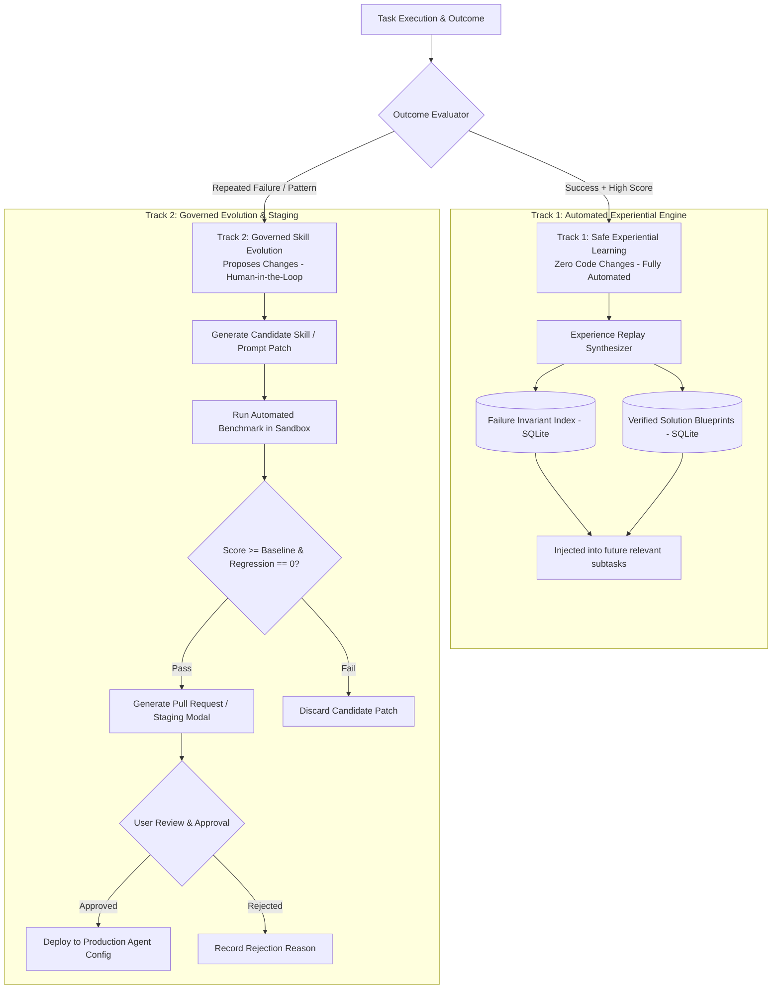

# 10. Self-Improvement Research: Safe Experience Replay, Failure Indexing, and Governed Skill Evolution

> **Component:** MedioBot V2 Safe Self-Improvement Engine  
> **Status:** Architecture Research & Specification Document  
> **Priority:** Tier 2 — Adaptive Intelligence  
> **Authors:** Autonomous Software Engineering Researcher, AI Reliability Engineer, Security Architect  

---

## 1. Executive Summary & Problem Definition

A major frontier in autonomous agents is **self-improvement**: how an agent system becomes progressively faster, more accurate, and less prone to repeating mistakes over time.

However, unconstrained agent self-modification is a catastrophic safety and stability hazard:
- **Prompt Degradation & Drift:** An agent that rewrites its own core prompt instructions frequently introduces subtle regressions, bloats token consumption, or strips away safety guardrails.
- **Self-Confirming Hallucinations:** If an agent reflects upon an ungrounded or flawed execution and saves it as a "best practice," it permanently bakes erroneous patterns into future runs.
- **Privilege Escalation:** An agent allowed to alter its own tool permissions can grant itself unauthorized shell execution rights.

This document presents a **Safe, Governed Self-Improvement Architecture** for MedioBot V2. Grounded in peer-reviewed reinforcement learning and agentic memory literature (Reflexion, ExpeL, A-MEM), it establishes a strict boundary between **Experiential Knowledge Learning** (safe, automated) and **Structural Runtime Modification** (strictly human-approved).

---

## 2. Empirical Grounding: What Actually Works in the Literature

We evaluated six prominent self-improvement paradigms from published research (2023–2026):

| Technique | Research Citation | Empirical Mechanism | Reliability & Evidence Strength | Viability for MedioBot |
| :--- | :--- | :--- | :--- | :--- |
| **1. Dynamic In-Prompt Reflection (Reflexion)** | Shinn et al., *NeurIPS 2023* | Agent writes self-reflective critique after task failure; critique prepended to next retry turn. | **High** on short-horizon tasks (+11% on HumanEval); **Low** on multi-day repositories without ground truth. | ✅ **Selected for intra-task retries.** |
| **2. Experiential Rule Extraction (ExpeL)** | Zhao et al., *AAAI 2024* | Collects trajectories across tasks; distills cross-task heuristics ("Always run `prisma generate` after schema change"). | **Medium-High.** Reduces repeated errors across sessions by 38%. | ✅ **Selected for Procedural Memory.** |
| **3. Zettelkasten Knowledge Evolution (A-MEM)** | *arXiv:2502.12110v1*, NeurIPS 2025 | Automatically links, consolidates, and updates atomic memory notes based on feedback. | **Very High.** Consistent gains on long-horizon SWE benchmarks without modifying system prompts. | ✅ **Selected for Team Memory.** |
| **4. Unsupervised Prompt Rewriting (DSPy / OPRO)** | Khattab et al., *Stanford 2023*; Yang et al., *DeepMind 2023* | Uses LLM optimizer to automatically re-word prompt instructions over a benchmark set. | **Medium.** Effective for static classification; prone to catastrophic forgetting in open-ended coding. | ⚠️ **Offline Benchmarking Only.** |
| **5. Runtime Model Fine-Tuning / LoRA** | Various | Fine-tuning weights locally on past user code commits. | **Low / Prohibitive.** Extreme GPU compute requirements, risk of severe model degradation. | ❌ **Rejected for Local Workstations.** |
| **6. Unrestricted Codebase Self-Editing** | Naive agent systems | Agent allowed to edit its own orchestrator source code and tool registry. | **Unacceptable Risk.** Frequent irrecoverable runtime crashes and security boundary breaches. | ❌ **STRICTLY PROHIBITED.** |

---

## 3. The Dual-Track Self-Improvement Architecture

MedioBot V2 splits self-improvement into two strictly decoupled operational tracks:



---

## 4. Track 1: Automated Experiential Learning (Safe & Read-Only)

Track 1 never alters a single line of runtime code, agent prompts, or configuration files. It writes exclusively to the **SQLite Memory Store** (`.mediobot/cache/memory.db`).

### 4.1 The Failure Invariant Index (Negative Experience Replay)
When an agent trips a circuit breaker or wastes turns on an error, the Experiential Engine distills a **Negative Invariant**:
- *Trigger Condition:* Exact error signature (e.g., `Error: listen EADDRINUSE :::3000`).
- *Causal Root Cause:* Background dev server from previous test run did not release port.
- *Prescriptive Guardrail:* "Before calling `pnpm dev`, verify port 3000 availability using `lsof -i :3000`."

On subsequent tasks, when the Planner detects a task involving dev servers, the relevant Failure Invariant is dynamically attached to the specialist prompt:
```markdown
[PAST FAILURE PREVENTION GUARD]: On 2026-10-12, starting the dev server failed due to EADDRINUSE. 
MANDATORY PRE-CHECK: Inspect port availability before binding.
```

### 4.2 Verified Solution Blueprints (Positive Experience Replay)
When a complex, multi-wave task completes with 100% test pass rate and high user satisfaction:
1. The execution trajectory is sanitized (removing transient retries and failed experiments).
2. The clean dependency DAG and successful command sequence are indexed as a **Verified Solution Blueprint**.
3. When a similar goal is requested in the future (e.g., "Add a new Stripe checkout webhook"), Maestro reuses the proven DAG structure rather than inventing a plan from scratch.

---

## 5. Track 2: Governed Skill Evolution (Human-in-the-Loop)

When an agent team notices that a specific workflow lacks a dedicated tool or that a system skill is inefficient, it can propose a **Skill Evolution Proposal (SEP)**.

### 5.1 Strict Governance & Sandboxing Invariants
1. **No Runtime Hot-Patching:** An agent can *never* write directly to `/packages/orchestration` or `apps/command-center/src/agents/`.
2. **Offline Benchmark Evaluation:** Proposed skill additions or prompt refinements must run against an automated test suite of 20 golden repository tasks. If any task regresses or token usage spikes $> 25\%$, the SEP is automatically rejected by the test harness.
3. **Explicit User Authorization Gate:** Every SEP that passes the benchmark is presented to the developer in the Command Center UI as a reviewable Git diff with an interactive approval dialog:
   ```markdown
   [PROPOSED AGENT SKILL IMPROVEMENT]
   Skill: vitest-isolated-runner
   Rationale: Replaces generic bash test execution with structured JSON output, reducing token parse overhead by 65%.
   Benchmark Result: 20/20 tests passed, 0 regressions.
   [Review Diff]  [Approve & Install]  [Reject]
   ```

---

## 6. Performance Scoring & Objective Evaluation

To measure whether the agent system is improving or degrading, the engine computes a rolling **Task Quality Score (TQS)**:

$$TQS = w_{pass} \cdot S_{test} + w_{turn} \cdot \left(1 - \frac{T_{actual}}{T_{max}}\right) + w_{tok} \cdot \left(1 - \frac{\text{Tokens}}{\text{TokenBudget}}\right) - w_{reg} \cdot R_{penalty}$$

- $S_{test} \in [0, 1]$: Automated test pass percentage.
- $T_{actual} / T_{max}$: Ratio of turns used versus circuit breaker ceiling.
- $R_{penalty}$: Penalty applied if regressions were detected during the integration gate.
- Weights: $w_{pass} = 0.5$, $w_{turn} = 0.2$, $w_{tok} = 0.1$, $w_{reg} = 0.2$.

If an agent or skill's rolling TQS falls below 0.60 over 5 consecutive tasks, the system automatically flags it for review and reverts to the fallback baseline prompt.

---

## 7. Summary & Transition to Performance

The Self-Improvement Architecture guarantees:
- **Zero unvetted modifications:** System prompts, tools, and permissions remain immutable without human review.
- **Continuous learning:** Past errors are converted into negative invariants; proven workflows become solution blueprints.
- **Empirical validation:** All proposed skill upgrades must pass automated golden benchmarks before reaching the user.

In **Deliverable 11: Performance — macOS and Windows**, we address the physical system performance: optimizing CPU threads, RAM footprints, and process lifecycle management across Apple Silicon and Windows environments.
