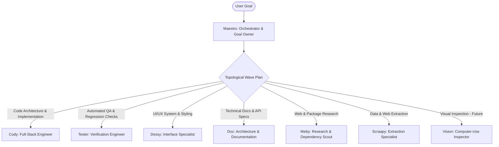
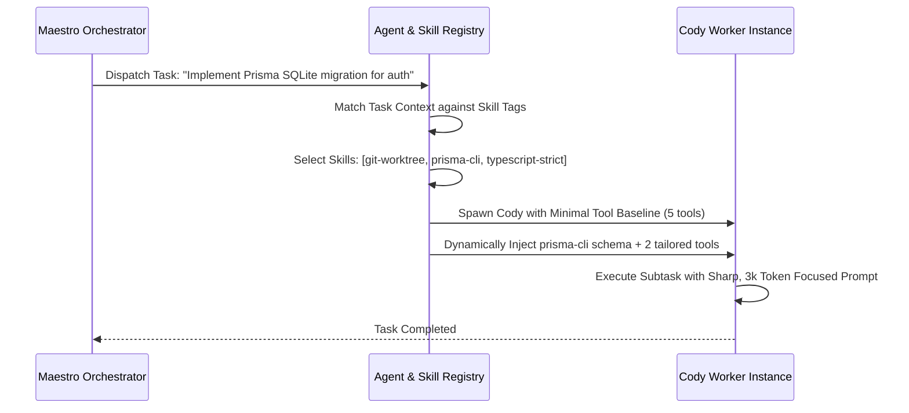
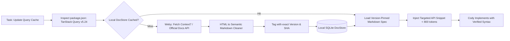

# 8. Specialist Agent Design: Personas, Tool Boundaries, and Dynamic Routing

> **Component:** MedioBot V2 Specialist Agent System  
> **Status:** Architecture Research & Specification Document  
> **Priority:** Tier 1 — Agentic Organization  
> **Authors:** Autonomous Software Engineering Researcher, Multi-Agent Orchestration Researcher, Context Engineering Specialist  

---

## 1. Executive Summary & Repository Reality Audit

The MedioBot V2 vision models an autonomous Agile engineering team where specialized agents possess distinct identities, bounded toolsets, and deep domain capabilities.

### 1.1 Repository Reality vs. Planned Specification
An exhaustive audit of the existing codebase (`packages/runtime/src/agents/`, `packages/orchestration/src/maestro.ts`, and `apps/command-center/src/server.ts`) reveals the current implementation baseline:

| Agent Name | Current Status in Codebase | Implemented Tools & Runtimes | Limitations in V2 Baseline |
| :--- | :--- | :--- | :--- |
| **Maestro** | Implemented (`MaestroOrchestrator`) | Task breakdown, prompt dispatch, delegate to Cody. | Purely sequential; delegates only to Cody; hardcoded fallback turns. |
| **Cody** | Implemented (`cody.ts`, runtime agent) | `run_command`, `read_file`, `write_to_file`, `list_files`, `grep_search`. | Generalist coding; attempts to do architecture, coding, testing, and research all in one prompt. |
| **Tester** | Registered in UI; stubbed backend | Reuses generic tools. | No isolated test runner, no test fixture mutation sandboxing. |
| **Dessy** | Registered in UI; prompt persona | No specialized CSS/component tools. | No UI token extraction, no visual perception tools. |
| **Weby** | Registered in UI; prompt persona | Generic web search (`brave_search`). | No image asset asset verification, no license-checking tool. |
| **Doc** | Registered in UI; prompt persona | Generic file read/write. | No API schema parser, no doc version retrieval. |
| **Scraapy** | Registered in UI; prompt persona | Generic fetch URL. | No DOM extractor, no structured markdown conversion. |
| **Vision** | Stubbed / Not implemented | Placeholder UI toggles. | Computer-vision and UI screenshot perception engine not connected to local runtime. |

This document formalizes the **Specialist Agent Roster**, defining explicit prompt contracts, tool permission boundaries, dynamic skill loading mechanisms, and model routing strategies for each role.

---

## 2. The Specialist Agent Roster: Matrix of Responsibilities



### 2.1 Detailed Role Specifications

#### 1. Maestro (Principal Coordinator & Goal Owner)
- **Role:** Product Manager and Engineering Lead. Breaks user requests into dependency DAGs, assigns specialists, monitors progress ledgers, resolves cross-agent blockers, and presents final deliverables.
- **Tools:** `plan_task_dag`, `dispatch_wave`, `inspect_agent_ledger`, `merge_worktree`, `request_user_approval`, `complete_goal`.
- **Restricted Tools:** *Cannot* directly edit source code files (`write_to_file` disabled). Maestro orchestrates; specialists write.
- **Model Routing:** Reasoning-heavy frontier model (e.g., Claude 3.7 Sonnet / MiniMax M2.7 / GPT-4o) with extended thinking.

#### 2. Cody (Principal Software Engineer)
- **Role:** Core backend and frontend implementation. Translates architectural specs into idiomatic, typed, modular code.
- **Tools:** `read_file`, `write_to_file`, `replace_file_content`, `run_command` (scoped to worktree), `query_repomap`, `search_symbols`.
- **Restricted Tools:** Cannot merge directly into `main` (must submit to Integration Gate).
- **Model Routing:** Code-specialized frontier model with high SWE-bench benchmarks.

#### 3. Tester (Quality Assurance & Reliability Engineer)
- **Role:** Test-driven development, regression testing, mutation testing, and security boundary validation.
- **Tools:** `run_test_suite`, `inspect_test_coverage`, `generate_test_fixtures`, `check_typecheck`, `read_file`, `write_to_file` (scoped strictly to `tests/` and `__tests__/`).
- **Restricted Tools:** Cannot modify production application code outside test directories.
- **Model Routing:** Fast, high-precision deterministic model (e.g., Claude 3.5 Sonnet / GPT-4o).

#### 4. Dessy (UI/UX & Design System Specialist)
- **Role:** Design token management, CSS/Tailwind architecture, responsive layouts, micro-animations, and component accessibility (WCAG AA).
- **Tools:** `read_file`, `write_to_file` (scoped to styles and view components), `inspect_design_tokens`, `preview_component`.
- **Restricted Tools:** Cannot modify backend database models, migrations, or server routes.
- **Model Routing:** Visual and design-oriented code model.

#### 5. Doc (Documentation & Schema Architect)
- **Role:** Technical documentation, OpenAPI/Swagger specifications, READMEs, architectural decision records (ADRs), and JSDoc maintenance.
- **Tools:** `read_file`, `write_to_file` (scoped to `docs/`, `*.md`, and docstrings), `query_api_routes`, `fetch_library_docs`.
- **Restricted Tools:** Cannot execute arbitrary shell commands.
- **Model Routing:** High-speed context-efficient language model.

#### 6. Weby & Scraapy (Research, Intelligence & Extraction)
- **Role:** Discover authoritative documentation, evaluate npm dependencies, verify library version compatibility, extract reference API patterns.
- **Tools:** `search_web`, `fetch_url_markdown`, `check_package_advisories`, `verify_license`.
- **Restricted Tools:** Read-only web access. Zero filesystem write access (all discoveries returned as structured evidence artifacts).
- **Model Routing:** Fast, cost-effective inference model (e.g., Gemini 2.5 Flash / Claude 3.5 Haiku).

---

## 3. Dynamic Skill Loading & Just-in-Time Tool Registration

Injecting 40 tools and 50 pages of instructions into every agent prompt is a catastrophic anti-pattern: it degrades model reasoning, wastes tokens, and triggers tool confusion.

MedioBot V2 adopts **Just-in-Time (JIT) Skill & Tool Binding**:



### 3.1 Progressive Tool Disclosure
1. **Core Universal Baseline (5 tools):** `read_file`, `write_to_file`, `search_project`, `run_worktree_command`, `submit_task_evidence`.
2. **Dynamic Domain Skills:** Attached on-demand based on task metadata:
   - If task involves frontend styling $\to$ load `tailwind-inspector` skill.
   - If task involves external API $\to$ load `openapi-validator` skill.
   - If task involves testing $\to$ load `vitest-runner` skill.
3. This keeps the active prompt overhead under **1,500 tokens for system context**, leaving maximum budget for source code and AST reasoning.

---

## 4. Authoritative Documentation Retrieval: Version-Aware & Source-Attributed

A primary cause of code hallucination is models guessing APIs for libraries updated after their training cutoff (or mixing up Next.js 13 Pages router with Next.js 15 App router).

### 4.1 The Documentation Retrieval Pipeline
When an agent encounters a library dependency (e.g., `@tanstack/react-query` v5):



- **Strict Source Attribution:** Every documentation snippet injected into an agent prompt includes:
  `// Source: docs.tanstack.com/query/v5/caching | Fetched: 2026-10 | Status: Verified`
- **Budget Capping:** Documentation injection is hard-capped at 1,000 tokens per subtask, providing only the exact method signatures and example usage needed.

---

## 5. Cross-Agent Communication & Evidence Artifacts

Agents do NOT communicate via free-form unstructured chat chatter (which causes infinite conversational loops and token drain).

Instead, all inter-agent communication is conducted through **Structured Evidence Artifacts (SEAs)** stored on disk in `.mediobot/tasks/{taskId}/artifacts/`:

```typescript
export interface StructuredEvidenceArtifact {
  taskId: string;
  agentId: string;
  objective: string;
  status: 'COMPLETED' | 'BLOCKED' | 'FAILED';
  filesModified: string[];
  testResults: {
    passed: number;
    failed: number;
    coveragePct: number;
  };
  keyDecisions: string[];
  blockersOrCaveats: string[];
  provenanceCitations: {
    file: string;
    lineRange: [number, number];
    sha256: string;
  }[];
}
```

When Maestro reviews a completed wave or passes context to the next wave, it injects only the `StructuredEvidenceArtifact` summary (typically 200–350 tokens) rather than the entire 50-turn conversational history of the specialist agent.

---

## 6. Summary & Transition to Reliability

The Specialist Agent Architecture delivers:
- **Role Bounding:** Strict separation between orchestration, implementation, testing, and design.
- **Least-Privilege Tool Access:** QA agents cannot break production code; research agents have read-only permissions.
- **JIT Skill Binding:** 70% reduction in system prompt bloat.
- **Version-Pinned Documentation:** Eliminates synthetic API hallucinations.

In **Deliverable 9: Reliability and Verification**, we formulate the mathematical verification protocols, dual-gate invariants, and failure classification taxonomies that guarantee code correctness.
